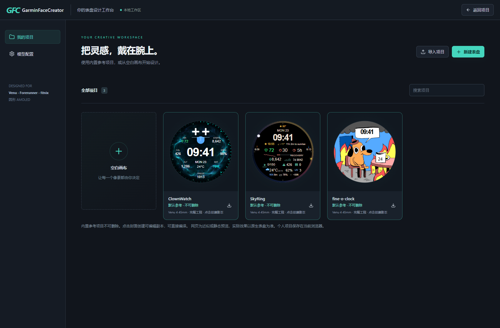
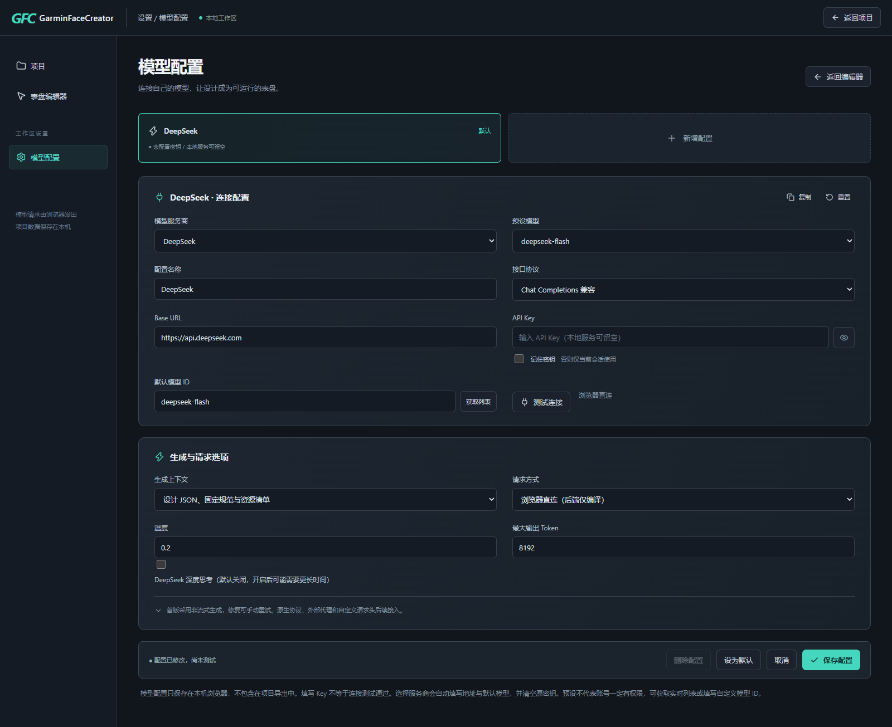
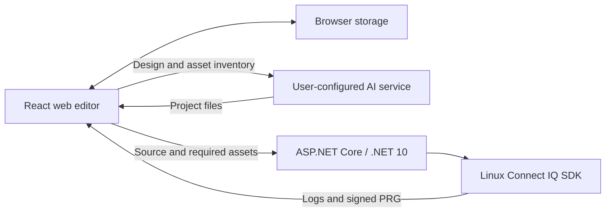

# GarminFaceCreator

[简体中文](readme.md) | **English**

A visual watch-face designer for Garmin Connect IQ. Arrange components, layers, and assets in a web editor, use your own AI provider to generate a Monkey C project from the browser, and compile it into a PRG with the .NET backend.

> This project is under development. Web previews use simulated data. A successful build does not mean the watch face has been validated on a physical device.

## Screenshots

### Projects and reference watch faces



### Visual editor


### Live preview and active / always-on comparison


### AI model settings



The screenshots show the current Chinese interface.

## Features

- Atomic browser saves with conflict recovery, schema migration, and design JSON import/export.
- Round canvas with four-corner resizing, marquee/Shift selection, snapping, batch actions, alignment, undo, and redo.
- Time, date, metrics, text, images, rings, and basic shapes.
- Independent preview with the current time, random heart rate, increasing step count, scenario presets, playback controls, and active / always-on comparison.
- Watch series, model, and case-size selection when creating a project, with the actual screen resolution displayed.
- Built-in ClownWatch, SkyRing, and fine-o-clock reference projects that create independent editable copies.
- AI provider presets, custom compatible endpoints, connection checks, and model-list retrieval.
- Separate design/code snapshots and retention limits; generation, raw failure recovery, review, and stale-code protection.
- Configurable rings, threshold ranges/fallbacks, metric typography, independent AOD styles, and round-screen clipping inspection.
- Complete native source ZIP export with version metadata, resources, and applicable original notices.
- Per-target compiler readiness, incremental logs/reconnection, cancellation, timeouts, retention, and signed PRG downloads.
- Download names follow `Model_Size_ProjectName.prg`, with whitespace removed and invalid filename characters handled.

AI-assisted canvas editing, automatic build-error repair, and full native simulator previews are not implemented yet. Some reference previews use approximate layers or animation stills; the native project determines the actual rendering.

## Supported devices

| Series | Model | Case size | Screen resolution |
| --- | --- | --- | --- |
| Venu | Venu 4 | 41 / 45 mm | 390×390 / 454×454 |
| Venu | Venu 3 / 3S | 45 / 41 mm | 454×454 / 390×390 |
| Forerunner | Forerunner 570 | 42 / 47 mm | 390×390 / 454×454 |
| Forerunner | Forerunner 970 | 47 mm | 454×454 |
| fēnix | fēnix 8 AMOLED | 43 / 47 / 51 mm | 416×416 / 454×454 / 454×454 |

All listed screens are round AMOLED displays. Designs use a normalized 454×454 coordinate system. Generation prompts include the target model, actual resolution, and scaling requirements. Built-in native reference projects currently target Venu 4 45 mm; compatibility with other devices is not automatically guaranteed.

## Architecture and data flow



- API keys stay in the browser, either for the current session or persistently if requested. They are excluded from prompts, standard project exports, and build requests.
- Images are stored in the browser. The current build workflow uploads required assets to the backend; asset handling is not fully offline.
- The browser calls AI providers directly, so the provider must allow CORS. The backend does not proxy AI requests.
- The build service does not execute uploaded shell or build scripts.
- The application is currently intended for personal self-hosting. Authentication and multi-user isolation are not implemented.

## Getting started

Install Node.js 24 and the .NET 10 SDK. Watch-face compilation also requires Docker, Java 17, the Linux Connect IQ SDK, target device packages, fonts, and a signing key that you manage yourself.

```bash
git clone https://github.com/yusger/GarminFaceCreator.git
cd GarminFaceCreator
npm ci
npm run build
dotnet build backend/GarminFaceCreator.Api.csproj -c Release
```

For frontend-only development, run `npm run dev` and open `http://localhost:5173`. You can edit and export designs without a connected build service, but you cannot generate a PRG.

See the [backend deployment guide](docs/backend-deployment.md) for deployment, SDK initialization, and volume mounts. The SDK, device packages, fonts, and private signing keys are not distributed with this repository and must be supplied separately.

## Documentation and repository layout

The detailed guides are currently in Chinese:

- [Editor usage and feature scope](docs/frontend-running.md)
- [Backend API and container deployment](docs/backend-deployment.md)
- [Frontend design plan](docs/frontend-design.md)

```text
frontend/         React, TypeScript, SVG editor, and reference packages
backend/          .NET 10 build API and integration tests
deploy/           Dockerfiles, initialization, and helper scripts
scripts/          Reference-package generation tools
docs/             Guides, design documents, and screenshots
compose.yaml      Container configuration
```

Run browser tests with `npm test`. Set `GFC_TEST_URL` to test against a deployed service without starting a local development server. Tests that call a real AI service require a key supplied through an environment variable and may incur provider charges.

## Reference projects and acknowledgments

The following reference watch faces come from the open-source community and have been adapted and integrated into this editor:

- **SkyRing**: [daveshap/SkyRingGarmin](https://github.com/daveshap/SkyRingGarmin), by [daveshap](https://github.com/daveshap).
- **fine-o-clock / Fine’o clock**: [causeri3/fine-o-clock](https://github.com/causeri3/fine-o-clock), by [causeri3](https://github.com/causeri3).

Thank you to both authors for sharing their watch-face source code and designs. Their work provides a foundation for the reference layouts, data displays, and animations, as well as practical examples for the visual editing and compilation workflow. The original projects and assets retain their respective copyrights and licenses.

## License and third-party content

This project is released under [GNU GPL v3 or later](LICENSE). Third-party reference projects, fonts, and images retain their own copyrights and licenses; see [Third-party notices](THIRD_PARTY_NOTICES.md). The project license does not grant additional rights to trademarks, characters, or illustrations.

License review: SkyRing upstream licensing is not verified. fine-o-clock README states GPLv3+, while its original LICENCE is LGPLv3; both are retained and the discrepancy is documented. Public source alone is not treated as complete redistribution authorization. See [third-party notices](THIRD_PARTY_NOTICES.md), [source export](docs/source-export.md), [device checklist](docs/device-self-test.md), and [stage validation](docs/stage-validation.md).

Preview uses browser rendering and simulated metrics. Native fonts, color depth, AOD lifecycle and refresh limits need target-device checks; no power estimate is inferred from the web preview. See [preview limitations (Chinese)](docs/preview-limitations.md). Use the bilingual [issue forms](https://github.com/yusger/GarminFaceCreator/issues/new/choose) for bug reports or feature requests, with credentials and private data removed.

A limited browser-local generator supports unrotated time, ASCII text and basic shapes without an AI call. Manual AI repair accepts selected text files and reviewed redacted logs, allows at most two requests per generation root in the current browser, and requires diff review before applying. Existing source is snapshotted and patch provenance is recorded. See [local generation](docs/local-generator.md) and [bounded repair](docs/ai-repair.md).

The static icon gallery includes pinned Lucide and Meteocons originals with attribution. Search and insert icons, change colors and Lucide stroke width, and export only referenced raster assets with their original SVGs and full notices. Monochrome icons can bind to cached Garmin weather with manual day/night styles and a missing-data fallback; see [icon library](docs/icon-library.md).

Reference cards and source archives preserve per-content attribution and known license uncertainties. Fixed native templates carry their repository notice and matching source-context snapshots when available; independent output is not blanket-relicensed by the editor. New reference packages require a pinned upstream commit and reviewed license. See [attribution workflow](docs/attribution.md).

**Editable Crystal reference**: thanks to [warmsound/crystal-face](https://github.com/warmsound/crystal-face). The initial Venu 4 45mm adaptation provides independent hours/minutes, date, basic live metrics and curved fixed-goal meters. The pinned source revision, full GPLv3 license and [adaptation scope](frontend/public/reference-notices/Crystal-ADAPTATION.md) are retained. It uses system fonts and curated Lucide icons.

**Editable TimelyFenix reference**: thanks to [KWottrich/TimelyFenix](https://github.com/KWottrich/TimelyFenix). A dynamic three-week calendar, week-start/theme controls and cached Garmin weather are editable. Pinned GPLv3 provenance and [adaptation scope](frontend/public/reference-notices/TimelyFenix-ADAPTATION.md) are retained; original icon fonts are not copied.

**Editable AboutTime reference**: thanks to [Samuel Rinnetmäki / garmin-abouttime](https://github.com/samuelmr/garmin-abouttime). Three independently editable rows support English and Simplified Chinese. Original MIT locale phrases and Creator GPLv3+ template scope are retained separately; see [adaptation notes](frontend/public/reference-notices/AboutTime-ADAPTATION.md).
