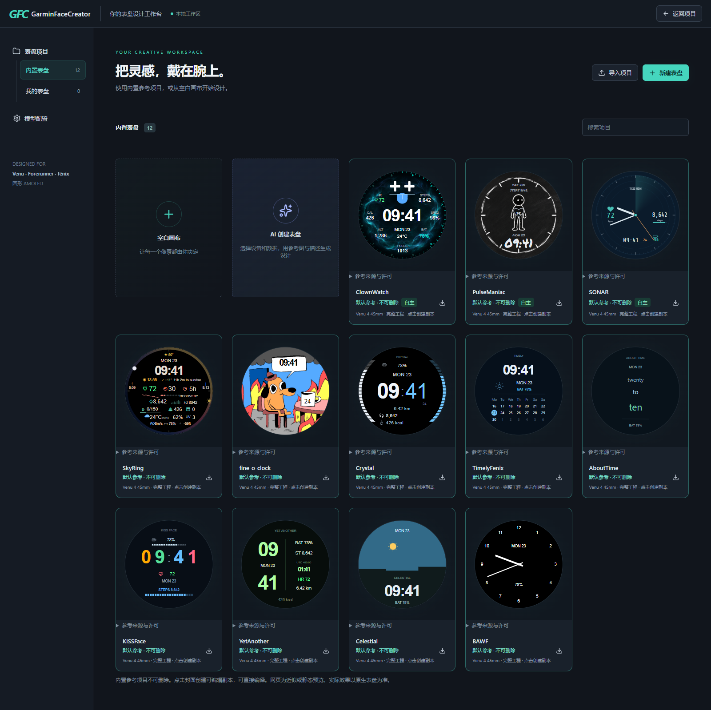
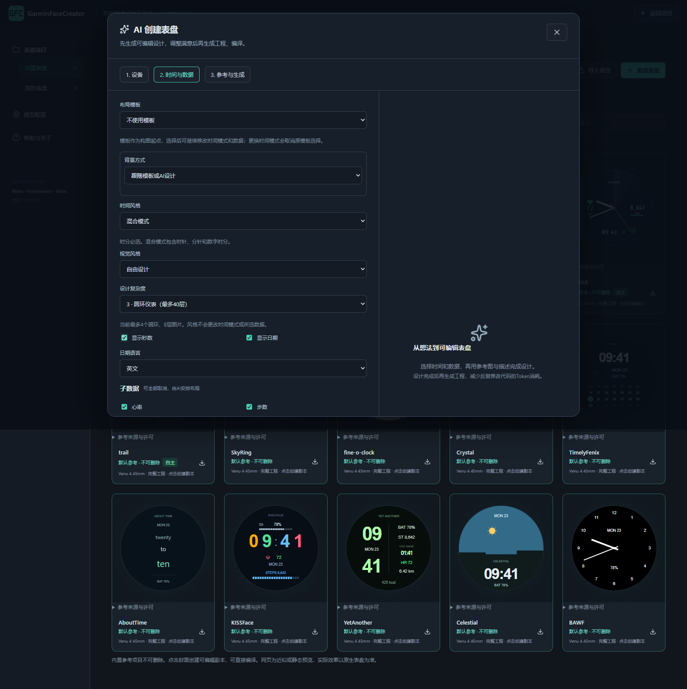
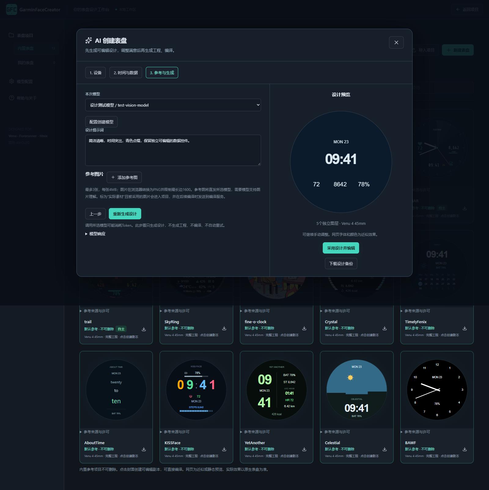
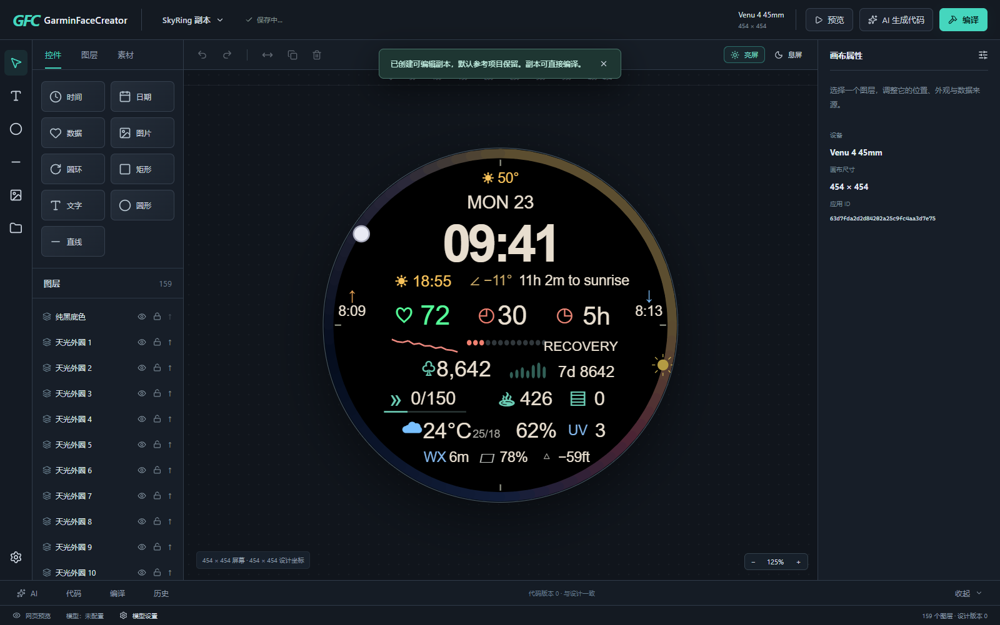
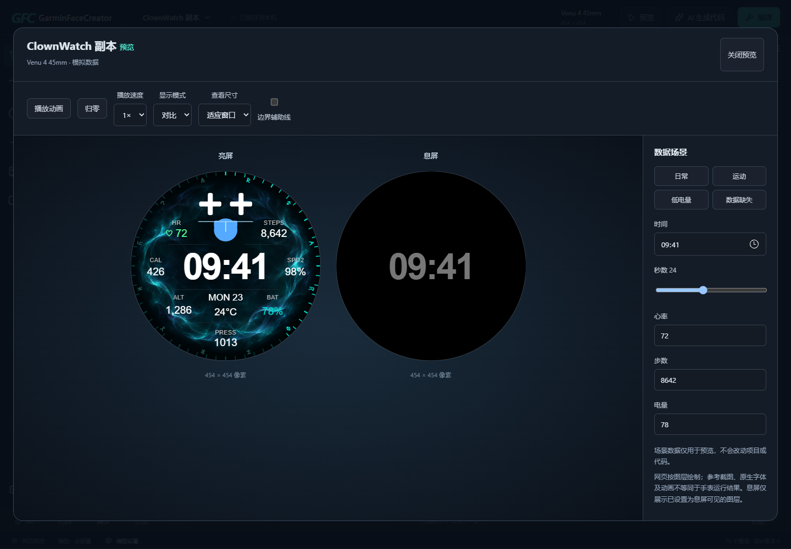
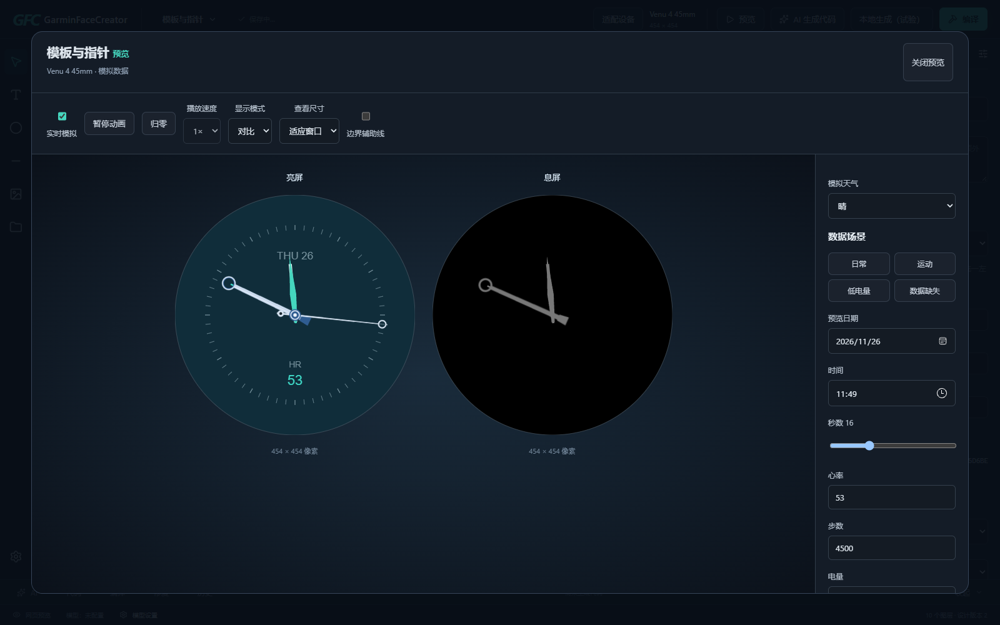
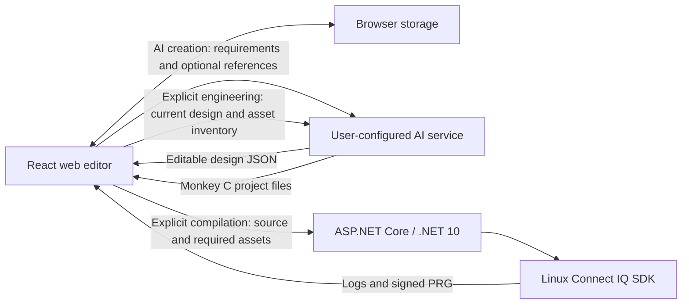

# GarminFaceCreator

[简体中文](readme.md) | **English**

A visual watch-face designer for Garmin Connect IQ. Start with a blank canvas, a built-in reference, or an AI-created editable design. Refine the design first, then explicitly generate a Monkey C project with your own AI provider and compile it into a PRG with the .NET backend.

> This project is under development. Web previews use simulated data. A successful build does not mean the watch face has been validated on a physical device.

## Live demo

[Open the GarminFaceCreator public demo](https://ddd.yusg.xyz:61888)

Try editing, previews, AI creation and real PRG compilation. Default anonymous limits are 6 submission attempts per minute and 30 builds per day per IP, with 200 builds per day across the service. Daily quotas reset at midnight UTC+8; visitors sharing a public IP share its quota. Configure your own model provider; provider usage charges apply.

Each task requires a separate access token for status, logs, downloads and cancellation. Tokens stay in the current browser session and are excluded from project exports. Rebuild after losing the session or for tasks created before this protection was introduced. Do not upload sensitive projects to the demo; self-host for production use. See [public demo protections and limitations](docs/public-demo-security.md).

## Screenshots

### Projects and reference watch faces



The Watchface Projects navigation separates built-in references from projects saved in your browser. Built-ins are protected and create editable copies; self-authored references appear first.

### AI watch-face creation

Choose a time style, seconds, date, and metrics, then add device settings, an AI model, reference images, and a prompt.





These wizard screenshots use fixed test responses to demonstrate the workflow, not a real model-quality benchmark. See also [device selection](docs/screenshots/ai-create-device.png) and the [hybrid example](docs/screenshots/ai-create-41mm.png).

### Visual editor



### Live preview and active / always-on comparison



### AI model settings


The screenshots show the current Chinese interface.

## Features

- Separate built-in and personal watchface lists, scoped search, self-authored badges and ordering; atomic browser saves, conflict recovery, schema migration, and design JSON import/export.
- AI-created editable designs from watch series/model/size, digital/analog/hybrid styles, seconds/date/metrics, reference images, and a prompt. Preview the result before adopting it.
- Separate design, engineering, and compilation actions. Manual edits do not call a model; generation supports cancellation, error/truncation feedback, raw-response downloads, and backup/retry after a failed browser save.
- Optional per-layer native-effect instructions are saved with the design and sent during later AI code generation. Web previews show the base layout; local generation explicitly rejects unsupported instructions.
- Round canvas with four-corner resizing, marquee/Shift selection, snapping, batch actions, alignment, undo, and redo.
- Time, date, metrics, text, images, rings, and basic shapes.
- Independent preview with the current time, random heart rate, increasing step count, scenario presets, playback controls, and active / always-on comparison.
- Watch series, model, and case-size selection with actual screen resolution; a project can share one master design across devices with individual overrides, code histories, and sequential builds.
- Optional AI layout suggestions for the current device, with payload review, before/after previews, explicit application, and a recoverable design snapshot.
- Owned PulseManiac default reference: four static HR-driven poses, configurable top data slots, live HR inside a chest heart, subdued auxiliary data and a handwritten chalk clock; the ready pose uses a matching black face.
- Data-driven layer visibility with explicit range boundaries, missing/AOD fallback, and target-sized static PNG resources.
- Twelve protected references: ClownWatch, SkyRing, fine-o-clock, Crystal, TimelyFenix, AboutTime, KISSFace, YetAnother, Celestial, BAWF, PulseManiac, and SONAR; each creates an independent editable copy.
- AI provider presets, custom compatible endpoints, connection checks, and model-list retrieval.
- Separate design/code snapshots and retention limits; generation, raw failure recovery, review, and stale-code protection.
- Configurable rings, threshold ranges/fallbacks, metric typography, independent AOD styles, and round-screen clipping inspection.
- Complete native source ZIP export with version metadata, resources, and applicable original notices.
- Per-target compiler readiness, incremental logs/reconnection, cancellation, timeouts, retention, and signed PRG downloads.
- Download names follow `Model_Size_ProjectName.prg`, with whitespace removed and invalid filename characters handled.

User-triggered AI repair supports up to two rounds with diff review and scoped files. Reviewed AI device-layout suggestions are available; unattended editing/repair and full native simulator previews remain future work. Some reference previews use approximate layers or animation stills; the native project determines the actual rendering.

## Layout templates and resource packages

Blank and AI creation can start from 12 editable layout templates, with solid colors or a local background image. Background images are processed in the browser and are not automatically sent as model references; compilation includes them in the submitted project. The material library provides 10 original bitmap hand sets and 3 polygon styles, with editable individual hands.

Canonical resources live in `resources/`: default watchfaces, layout templates, controls, images and shared fonts. Builds publish browser assets while preserving existing resource URLs.



See the [control package contract](docs/custom-widget-standard.md), [layout template contract](docs/layout-template-standard.md) and [hand asset contract](docs/hand-resource-standard.md). Custom control packages compose supported layers; new runtime effects still require application support.

## From design to PRG

| Step | Action | Model request |
| --- | --- | --- |
| 1. Create a design | Choose AI creation beside the blank canvas; select a device, time style, metrics, references, and a prompt, then generate the design | One explicit request; no automatic retries |
| 2. Refine it | Preview, adopt, then move components, change colors/fonts/sources, replace assets, and save | None |
| 3. Generate engineering files | Use the existing AI code generation action, review the files, and apply them; alternatively use local generation within its supported subset | AI generation makes a request; local generation does not |
| 4. Compile and download | Start the build, inspect logs, and download the PRG | None |

Design edits mark existing code as stale while preserving its history; they never trigger automatic regeneration. You can also start from a built-in copy or design manually on a blank canvas without AI design creation.

The initial wizard supports 24-hour time and integer seconds. 12-hour/AM–PM, lunar dates, solar terms, holidays, notification counts, and smooth sweeping seconds are not enabled. References can guide style/layout or serve as actual assets; only explicitly used assets enter the project. Image input requires a vision-capable model. Automatic raster-image generation is not included.

Custom native effects are implemented during later AI code generation. The web editor shows a basic or static approximation; actual effects require simulator/device checks. See the [AI creation guide](docs/ai-create.md) and [basic specification v1.1](docs/watchface-basic-spec.md), currently in Chinese.

## Supported devices

| Series | Model | Case size | Screen resolution |
| --- | --- | --- | --- |
| Venu | Venu 4 | 41 / 45 mm | 390×390 / 454×454 |
| Venu | Venu 3 / 3S | 45 / 41 mm | 454×454 / 390×390 |
| Forerunner | Forerunner 570 | 42 / 47 mm | 390×390 / 454×454 |
| Forerunner | Forerunner 970 | 47 mm | 454×454 |
| fēnix | fēnix 8 AMOLED | 43 / 47 / 51 mm | 416×416 / 454×454 / 454×454 |

All listed screens are round AMOLED displays. Designs use a normalized 454×454 coordinate system. Generation prompts include the target model, actual resolution, and scaling requirements. Built-in native reference projects currently target Venu 4 45 mm; copies can add device adaptations, with separate generation, compilation, and validation required. See the [multi-device guide](docs/multi-device.md) (Chinese).

## Architecture and data flow



- API keys stay in the browser, either for the current session or persistently if requested. They are excluded from prompts, standard project exports, and build requests.
- Reference images go directly from the browser to the chosen model, not to the build service during design creation. Images adopted as runtime assets stay in the local project and are uploaded when required for compilation.
- The browser calls AI providers directly, so the provider must allow CORS. The backend does not proxy AI requests.
- The build service does not execute uploaded shell or build scripts.
- Build quotas, upload deadlines, storage budgets and audit limits are configured in [backend/appsettings.json](backend/appsettings.json). Restart the backend after editing it; usage counters persist separately.
- Anonymous use has rate limits, daily quotas and per-task access tokens. Account login, full tenant isolation and professional DDoS protection are not implemented; see [deployment protections](docs/public-demo-security.md).

## Getting started

Install Node.js 24 and the .NET 10 SDK. Watch-face compilation also requires Docker, Java 17, the Linux Connect IQ SDK, target device packages, fonts, and a signing key that you manage yourself.

```bash
git clone https://github.com/yusger/GarminFaceCreator.git
cd GarminFaceCreator
npm ci
npm run build
dotnet build backend/GarminFaceCreator.Api.csproj -c Release
```

For frontend-only development, run `npm run dev` and open `http://localhost:5173`. You can edit and export designs without a connected build service, but you cannot generate a PRG.

See the [backend deployment guide](docs/backend-deployment.md) for deployment, SDK initialization, and volume mounts. The SDK, device packages, fonts, and private signing keys are not distributed with this repository and must be supplied separately.

## Documentation and repository layout

The detailed guides are currently in Chinese:

- [AI creation: design, editing, engineering, and compilation](docs/ai-create.md)
- [Basic watchface specification v1.1](docs/watchface-basic-spec.md)
- [Design-package specification v1.2](docs/watchface-package-standard.md)
- [SONAR sample and historical reviews](docs/sonar-package-review.md)
- [Editor usage and feature scope](docs/frontend-running.md)
- [Backend API and container deployment](docs/backend-deployment.md)
- [Frontend design plan](docs/frontend-design.md)

```text
frontend/         React, TypeScript, SVG editor, and reference packages
backend/          .NET 10 build API and integration tests
deploy/           Dockerfiles, initialization, and helper scripts
scripts/          Reference-package generation tools
docs/             Guides, design documents, and screenshots
compose.yaml      Container configuration
```

Run browser tests with `npm test`. Set `GFC_TEST_URL` to test against a deployed service without starting a local development server. Tests that call a real AI service require a key supplied through an environment variable and may incur provider charges.

## Reference projects and acknowledgments

The following reference watch faces come from the open-source community and have been adapted and integrated into this editor:

- **SkyRing**: [daveshap/SkyRingGarmin](https://github.com/daveshap/SkyRingGarmin), by [daveshap](https://github.com/daveshap).
- **fine-o-clock / Fine’o clock**: [causeri3/fine-o-clock](https://github.com/causeri3/fine-o-clock), by [causeri3](https://github.com/causeri3).

Thank you to both authors for sharing their watch-face source code and designs. Their work provides a foundation for the reference layouts, data displays, and animations, as well as practical examples for the visual editing and compilation workflow. The original projects and assets retain their respective copyrights and licenses.

## License and third-party content

This project is released under [GNU GPL v3 or later](LICENSE). Third-party reference projects, fonts, and images retain their own copyrights and licenses; see [Third-party notices](THIRD_PARTY_NOTICES.md). The project license does not grant additional rights to trademarks, characters, or illustrations.

License review: SkyRing upstream licensing is not verified. fine-o-clock README states GPLv3+, while its original LICENCE is LGPLv3; both are retained and the discrepancy is documented. Public source alone is not treated as complete redistribution authorization. See [third-party notices](THIRD_PARTY_NOTICES.md), [source export](docs/source-export.md), [device checklist](docs/device-self-test.md), and [stage validation](docs/stage-validation.md).

Preview uses browser rendering and simulated metrics. Native fonts, color depth, AOD lifecycle and refresh limits need target-device checks; no power estimate is inferred from the web preview. See [preview limitations (Chinese)](docs/preview-limitations.md). Use the bilingual [issue forms](https://github.com/yusger/GarminFaceCreator/issues/new/choose) for bug reports or feature requests, with credentials and private data removed.

An optional browser-local generator handles a supported subset of time, data, shapes, images, and other components without an AI call. Nonempty native-effect instructions require AI engineering or explicit removal; they are never silently ignored. Manual AI repair accepts selected text files and reviewed redacted logs, allows at most two requests per generation root in the current browser, and requires diff review before applying. Existing source is snapshotted and patch provenance is recorded. See [local generation](docs/local-generator.md) and [bounded repair](docs/ai-repair.md).

The static icon gallery includes pinned Lucide and Meteocons originals with attribution. Search and insert icons, change colors and Lucide stroke width, and export only referenced raster assets with their original SVGs and full notices. Monochrome icons can bind to cached Garmin weather with manual day/night styles and a missing-data fallback; see [icon library](docs/icon-library.md).

Reference cards and source archives preserve per-content attribution and known license uncertainties. Fixed native templates carry their repository notice and matching source-context snapshots when available; independent output is not blanket-relicensed by the editor. New reference packages require a pinned upstream commit and reviewed license. See [attribution workflow](docs/attribution.md).

**Editable Crystal reference**: thanks to [warmsound/crystal-face](https://github.com/warmsound/crystal-face). The initial Venu 4 45mm adaptation provides independent hours/minutes, date, basic live metrics and curved fixed-goal meters. The pinned source revision, full GPLv3 license and [adaptation scope](frontend/public/reference-notices/Crystal-ADAPTATION.md) are retained. It uses system fonts and curated Lucide icons.

**Editable TimelyFenix reference**: thanks to [KWottrich/TimelyFenix](https://github.com/KWottrich/TimelyFenix). A dynamic three-week calendar, week-start/theme controls and cached Garmin weather are editable. Pinned GPLv3 provenance and [adaptation scope](frontend/public/reference-notices/TimelyFenix-ADAPTATION.md) are retained; original icon fonts are not copied.

**Editable AboutTime reference**: thanks to [Samuel Rinnetmäki / garmin-abouttime](https://github.com/samuelmr/garmin-abouttime). Three independently editable rows support English and Simplified Chinese. Original MIT locale phrases and Creator GPLv3+ template scope are retained separately; see [adaptation notes](frontend/public/reference-notices/AboutTime-ADAPTATION.md).

AboutTime: [English editor](docs/screenshots/abouttime-editor.png) · [Chinese editor](docs/screenshots/abouttime-zh-editor.png) · [native English](docs/screenshots/abouttime-en-native.png) · [native Chinese](docs/screenshots/abouttime-zh-native.png) · [AOD](docs/screenshots/abouttime-aod.png).


**Editable KISSFace reference**: thanks to [Delfim Machado / KISSFace](https://github.com/dbcm/KISSFace). Four independent time digits, cached HR/battery thresholds and dynamic segmented steps/battery meters. Original liquid digits and battery arc use an explicit downgrade; see [adaptation scope](frontend/public/reference-notices/KISSFace-ADAPTATION.md).


**Editable YetAnother reference**: thanks to [Laverlin / Yet-Another-WatchFace](https://github.com/Laverlin/Yet-Another-WatchFace). Split HH/MM, real activity data and an optional secondary clock are editable. Secondary time uses a fixed UTC offset without automatic destination DST; see [trimmed scope](frontend/public/reference-notices/YetAnother-ADAPTATION.md).


**Editable Celestial reference**: thanks to [Zachary Smith / Cutwell](https://github.com/Cutwell/garmin-celestial-watchface). Sky, sun/night marker, landscape, clock and battery are editable. Native uses Garmin sun times and passive cached position with explicit missing-data fallback. Browser sun times are labelled preview samples; see [adaptation scope](frontend/public/reference-notices/Celestial-ADAPTATION.md).


BYOD inspired a [round-screen modular layout proposal](docs/byod-modular-layout.md), with a pinned revision, original LGPL text and reviewed source-file records. This is architecture research, not an implemented region engine or a default reference.


**Editable BAWF analog reference**: thanks to [Kevin Boone / BAWF](https://github.com/kevinboone/BAWF). Explicit GPLv3 source copyright headers and complete license are retained. Hands, numerals, date and battery are editable; black/white variants use the same fixed Jungle after changing design colors. See [adaptation scope](frontend/public/reference-notices/BAWF-ADAPTATION.md); upstream power claims are not inherited.

Editable components also include segmented goal meters, a three-week calendar, English/Chinese word time, fixed-UTC-offset clocks, solar scenes and configurable-pivot clock hands. See [todo](todo.md) and [staged validation](docs/stage-validation.md) for scope and evidence.


See the [PulseManiac guide](docs/pulsemaniac.md) (Chinese) for creation, configuration, selected assets, generation prompts and actual browser/native screenshots. Original local drafting references are excluded from the repository.


Default watchface packages are maintained in [default-watchfaces](resources/default-watchfaces/README.md). ClownWatch, PulseManiac, and SONAR carry a self-authored badge on built-in cards; asset rights remain documented in each package’s notices.


[SONAR reference](docs/sonar.md): 18 editable layers, 12 controls, continuous progress and packaged fonts; static scan fallback.
