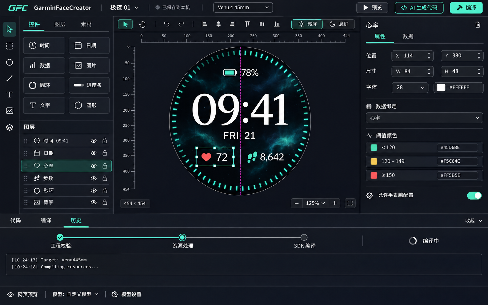
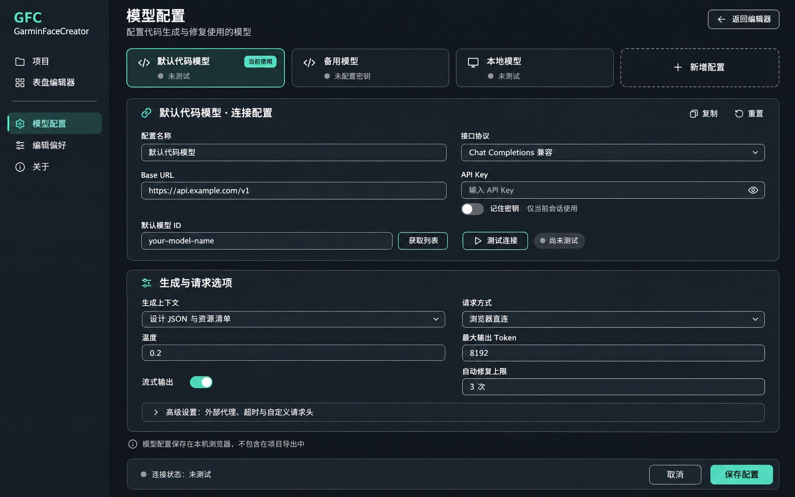

# GarminFaceCreator 前端设计规划

后端确定使用 **C# / ASP.NET Core / .NET 10**。前端先完成页面、编辑交互及本地数据闭环，再接入模型与编译服务。

状态（2026-11-24）：React/TypeScript 前端与 .NET 10 编译 API 已实现，已完成 P0 和 P1 主线的分阶段实现与远程验证。当前包含原子保存与冲突恢复、多选/框选、四角缩放、独立设计/代码快照、模型选择与安全解析、增量日志、源码 ZIP 导出、数据格式、可配置圆环/阈值/AOD。包含范围受限的本地生成试点与代码来源记录；项目 schema 为 v9，支持旧版顺序迁移。

本文后续章节保留产品设计方案，不表示所有规划项已交付。路由表是草案；自由路径、嵌套组件、AI 辅助修改、自动修复、更多原生协议等尚待实施。实际操作见 frontend-running.md，阶段证据见 stage-validation.md；docs/mockups 为早期 AI 实例图，docs/screenshots 为实际页面。

## 1. 设计目标与视觉方向

- 面向个人表盘制作，提供 Venu、Forerunner、fēnix 的系列/型号/尺寸选择；使用 454×454 设计坐标并按目标实际分辨率缩放。内置原生参考工程仍先面向 Venu 4 45mm。
- 中文为默认界面语言，项目名称、控件标签和数据名称采用 UTF-8。
- 主流程：打开项目 → 编辑设计 → AI 生成 → 审阅代码 → 编译 → 下载。
- 不要求每次编辑都调用 AI；普通操作即时更新设计与网页预览。
- 编辑器、模型设置和编译服务相互独立，未配置模型或后端离线时仍可编辑与保存。
- 深色石墨面板、低对比边框、青绿色主操作；红色用于错误，黄色用于注意状态。
- 避免把实现细节堆到常规操作里；高级参数、代码和日志按需展开。

视觉基准：背景 #14181F，面板 #1C222B，主色 #45D6BE，正文近白、辅助文字灰色。建议正文 14px，表单控件高 34～40px，间距以 8px 为单位，圆角 8px。

## 2. 页面与导航

| 页面/区域 | 路由草案 | 职责 |
| --- | --- | --- |
| 项目管理 | /projects | 新建、最近项目、模板、导入导出、删除 |
| 表盘编辑器 | /editor/:projectId | 画布、控件、图层、属性、AI 生成、构建 |
| 模型配置 | /settings/models | 多配置管理、协议、地址、密钥、连接测试 |
| 编辑偏好 | /settings/editor | 网格、吸附、主题及默认模拟数据，后续补齐 |
| 关于 | /about | 版本、资料入口及存储说明，低优先级 |

前 3 个页面为首版主页面。编辑器通过项目名称菜单返回项目管理，模型配置页提供返回编辑器。构建、预览和历史优先使用抽屉或弹窗，不拆成必须离开的独立页面。

## 3. 项目管理页

布局：顶部产品栏；左侧分类（最近、全部、模板）；右侧为项目卡片网格。

- 顶部操作：新建项目、导入项目、搜索。
- 卡片：预览缩略图、名称、设备、最近编辑时间、本地保存标记。
- 卡片操作：打开、重命名、复制、导出、删除。
- 空状态：新建空白表盘或导入示例，不展示假的历史数据。
- 新建弹窗：项目名称、模板、设备；提供已验证 SDK 目录中的设备选项，自动建立稳定项目 ID 和应用 ID。
- 当前模板：空白、基础数字表盘，以及 ClownWatch、SkyRing、fine-o-clock 默认参考副本；其他模板按 todo 分阶段加入。
- 删除需明确确认，失败时保留原记录；导入不自动覆盖同 ID 项目。

## 4. 主编辑器页面

### 4.1 总体布局

| 区域 | 建议尺寸 | 功能 |
| --- | --- | --- |
| 顶栏 | 56～64px | 项目、保存状态、设备、预览、AI 生成代码、编译 |
| 工具栏 | 48～56px 宽 | 选择、拖动、基本形状、文字、图片等快捷入口 |
| 左面板 | 248～272px | 控件、图层、素材页签 |
| 中央画布 | 剩余宽度 | 标尺、辅助线、圆形画布、缩放与显示模式 |
| 右属性面板 | 300～336px | 当前控件的属性、数据和显示条件 |
| 底部工作抽屉 | 折叠时约 40px，展开约 200～320px | 生成结果、代码、编译日志和历史 |
| 状态栏 | 28～32px | 网页预览标记、当前模型、选中控件和模型设置入口 |

首版优先桌面浏览器，建议宽度不小于 1280px、高度不小于 800px。窄窗口可折叠左右面板，不承诺手机端完成复杂拖拽。

画布逻辑尺寸始终是 454×454；缩放只影响编辑显示，不改变导出坐标。支持适应窗口、100% 和自定义缩放。显示圆形裁切边界和可切换的安全边界。

### 4.2 顶栏行为

- 项目菜单：重命名、导入、导出、返回项目。
- 保存状态：保存中、已保存到本机、保存失败；未落盘时不得显示已保存。
- 预览：打开模拟数据与显示模式面板，不宣称为 Garmin 模拟器。
- AI 生成代码：校验设计与模型配置后打开生成抽屉，不隐式覆盖已有代码。
- 编译：没有可用工程代码时提示先生成；已存在有效代码时直接提交固定目标构建。
- 设计变动后标记代码过期；旧工程仍可查看，但编译旧版本前需明确显示版本差异。

### 4.3 控件库

| 控件 | 首版属性与能力 |
| --- | --- |
| 时间 | 12/24 小时、字号、字体、颜色、对齐 |
| 日期 | 日期格式、星期、字号和颜色 |
| 数据读数 | 绑定数据、格式、单位、缺失值、阈值颜色 |
| 静态文字 | 文本、字号、颜色、对齐 |
| 图片 | 上传、坐标、尺寸、裁剪；仅开放已验证可导出的效果 |
| 基础图形 | 直线、矩形、圆形、圆弧，边框、填充、线宽 |
| 秒环/进度条 | 总刻度、起始角度、方向、明暗颜色、绑定秒数或目标进度 |
| 组合 | 图标、标签、数值组合，统一移动、复制 |

首版先交付时间、图片、数据、文字和基础图形。自由路径绘图、复杂组合和高级仪表分阶段加入，不把未实现控件展示为可用。

支持点击添加或拖入画布，采用明确默认尺寸。非线性透视、模糊滤镜等浏览器专属效果首版不开放，避免预览与导出不一致。

### 4.4 图层面板

- 层级顺序、名称、类型、显隐、锁定、选中状态。
- 拖动排序、重命名、复制、删除；后续支持分组、展开折叠。
- 锁定图层不参与画布拖动；隐藏图层不绘制，是否导出由明确规则决定。
- 全部画布选择与面板选择同步；多选时提示属性仅编辑主选图层；明确的批量操作通过工具栏执行。

### 4.5 属性面板

无选择时显示画布属性；单选时显示对应控件；多选时展示主选属性与批量操作提示。

- 基础：名称、X/Y、宽高、旋转、锚点、层级。
- 外观：填充、边框、线宽、字体和对齐。
- 数据：数据源、单位、格式、缺失值、阈值规则。
- 显示：亮屏、息屏、显示条件。
- 可配置：是否允许手表端/手机端更换数据或颜色、设置显示名称与默认值。
- 图像透明度、旋转和字体等能力按 Garmin 输出方案验证后开放，不仅依赖浏览器效果。

首版坐标采用左上角原点，尺寸为逻辑像素；控件锚点通过统一转换进入代码生成规范。

### 4.6 数据绑定

首批数据从现有表盘验证过的模块中选择：心率、步数、电量、总热量、血氧、海拔、天气温度、气压等。不同指标分别声明单位、范围、刷新频率与权限。

- 有效零值与缺失值分别处理。
- 阈值编辑器明确边界与区间顺序，不能产生重叠且未定义优先级的规则。
- 心率示例：低于 120 绿色、120～149 黄色、150 及以上红色；预览的颜色必须随模拟数值变化。
- 设置标签可中文化，内部 source/ID 保持稳定；翻译不能改变数据来源。
- 估算值、历史不完整等标记沿用现有数据模块规则。

### 4.7 预览与快捷操作

- 模拟数据：时间、秒数、心率、步数、电量、天气和缺失值状态。
- 亮屏/息屏切换，分别检查图层可见性。
- 撤销/重做、复制、删除、方向键微调、Shift 大步微调。
- 输入框获得焦点时，编辑器快捷键不得抢占正常输入。
- 网格、吸附、中心线与元素对齐线可切换。
- 主界面始终标识网页预览；真机性能、真实字体和像素占用仍需 SDK/设备验证。

## 5. 模型配置页

### 5.1 参考与布局

参考用户提供的 [AI Pose Gallery 设置页](https://ai-pose-gallery.anhao.app/settings) 截图中的信息组织方式：顶部横向配置卡片、中间连接配置、下方全局请求选项、底部保存操作。网页未能通过工具直接读取，设计依据为用户截图。

本项目沿用编辑器的深色石墨与青绿色视觉体系。旧版左右配置列表稿保留于 mockups/02-model-settings.png，仅供历史比较；本节 v2 为当前设计。

- 左侧：应用导航，模型配置为当前选中项。
- 页头：标题、用途说明、返回编辑器。
- 顶部：横向配置卡片，可滚动，包含配置名称、当前使用标记和连接状态，末尾提供新增配置。
- 中部：当前配置的连接表单，桌面两列排列，窄窗口变为单列。
- 下部：生成与请求选项，低频设置折叠。
- 底部：连接状态、取消和保存配置，保存不隐式调用模型。

卡片按用户保存的配置区分，不将厂商名称、协议和模型 ID 视为同一概念。示例“默认代码模型、备用模型、本地模型”为配置名称，不代表已经接入这些服务。

### 5.2 连接配置

| 字段 | 行为 |
| --- | --- |
| 配置名称 | 本地显示名称，支持多份配置；可重命名、复制、删除 |
| 接口协议 | 首版先实现 Chat Completions 兼容适配器；其他服务的原生协议需单独适配后开放 |
| Base URL | 验证 URL 格式；由适配器拼接请求路径，避免重复拼接版本与端点 |
| API Key | 默认遮挡，支持显隐；记住密钥默认关闭，仅会话保存 |
| 默认模型 ID | 手动输入始终可用；服务支持时可获取列表，获取失败不阻止手动填写 |
| 测试连接 | 发起最小真实测试，显示状态、响应/错误和耗时，与保存操作分离 |
| 复制/重置 | 复制默认不带密钥；重置仅当前配置且需确认，不清空其他配置 |

切换卡片时保留未保存草稿，并标记已修改。当前编辑卡片与生成时默认使用的配置分别表示，不因查看卡片自动切换默认模型。离开页面如有未保存修改，提供保存、放弃、继续编辑。

连接状态至少区分：未配置、未测试、测试中、可用、测试失败。只有真实测试成功才显示可用，不将已填 Key 误标为连接成功；参数改变后标记需要重新测试。

### 5.3 生成与请求选项

| 选项 | 首版规则 |
| --- | --- |
| 生成上下文 | 默认设计 JSON、固定模板和资源清单；附带预览图需用户选择且适配器/模型支持 |
| 请求方式 | 默认浏览器直连；可选择用户提供的外部代理 |
| 温度/输出 token | 按适配器能力发送；示例 0.2/8192 只是初始 UI 草案，不保证所有模型接受 |
| 流式输出 | 可开关；协议不支持时禁用或使用非流式结果 |
| 自动修复上限 | 可配置有限次数，示例 3 次；可关闭、可取消，实际请求由前端执行 |
| 高级设置 | 外部代理地址、请求超时和自定义请求头；敏感头与 Key 同级保存，不进入项目导出 |

全局选项只影响请求行为，不与各配置自己的地址、密钥和模型 ID 混存。协议相关参数按配置保存；不支持的参数不强行发送。

### 5.4 与参考站点的适配边界

- 借鉴页面结构，不照搬图片生成厂商列表和默认图片模型。这里优先配置代码生成及代码修复模型，后续再单独规划图片素材生成能力。
- 不自动启用参考截图中的服务端 /api/proxy，也不因选择某个厂商把模型请求改走 .NET 10 编译服务。
- 不默认上传本地素材到外部图床。设计 JSON 与资源清单是默认输入；模型需要看图时，由前端在明确选择后附带图像数据，并按协议能力处理。
- API Key 与敏感请求头仅用于模型/用户外部代理认证，不进入提示词、生成源码、日志、普通项目导出或构建请求。
- 用户选择外部代理时，它本身会接收相应请求与认证信息；这与“编译后端不接触模型 Key”是不同的服务边界。
- 不在模型配置页保存 Garmin 签名密钥。
- 浏览器无法精确区分的网络/CORS 问题按网络或跨域错误展示，不能声称总能定位为具体原因。
- 未测试配置可保存，生成前提示未验证状态；取消恢复已保存版本。
- 页面底部提示配置保存在本机浏览器，普通项目导出不包含模型私有配置。
## 6. AI 生成与代码审阅抽屉

编辑器顶部 AI 按钮打开抽屉，保持当前画布可返回。

1. 生成前校验设计、资源、目标和模型配置。
2. 展示可编辑的补充需求、设计摘要与本次将发送的资源信息。
3. 开始生成，展示流式状态与取消按钮。
4. 解析结构化文件清单，校验路径、输出格式及必需文件。
5. 展示文件树、代码和前后差异，提供应用、丢弃、重新生成。
6. 应用后建立代码快照，允许提交编译。

设计 JSON 是画布依据；AI 代码修改不自动反向修改画布。手动改过代码后，再生成需保留旧快照并确认覆盖生成文件。基础数据与动画模块不默认交给模型重写。

状态：空闲、校验中、生成中、待审阅、已应用、已取消、失败。失败不破坏最后一次有效代码。

## 7. 编译、日志与历史

底部抽屉包含生成结果/代码、编译、历史三个页签，展示内容与激活页签保持一致。

### 编译面板

- 提交后立即显示排队状态和任务 ID。
- 状态：未提交、排队、编译中、成功、失败、已取消、中断。
- 首版轮询任务状态和增量日志；后续再考虑 SSE 或其他实时传输。
- 日志支持级别筛选、复制、下载；有文件和行号时可跳转代码。
- 不捏造精确百分比或构建阶段；只能展示后端已确认的阶段与日志。
- 失败时提供复制错误、查看代码、AI 修复；修复仍由浏览器调用模型。
- 成功后可下载 PRG 和生成工程；只展示后端实际存在的产物。
- 编译失败时不把之前的成功产物误标为本次结果。

### 历史面板

- 设计快照、代码版本、生成模型配置名称、构建结果。
- 比较版本，恢复前保存当前状态。
- API Key 不进入历史快照。
- 模型自动修复设置有限重试次数，可随时停止。

## 8. 前端功能模块

前端规划采用 React + TypeScript 的组件化方案；首版以 SVG 场景表示文字、图片、路径和选择框，便于与设计 JSON 一一对应。具体依赖版本和画布性能需要在原型阶段验证。

| 模块 | 职责 |
| --- | --- |
| app-shell | 页面导航、工作区布局、主题 |
| projects | 项目列表、新建、复制、导入导出 |
| scene | 场景规范、图层树、选择、坐标转换 |
| editor | 画布交互、吸附、对齐、撤销重做 |
| controls | 各类控件的预览与属性定义 |
| assets | 图片资源、缩略图、资源 ID 和引用校验 |
| inspector | 属性表单、数据绑定、阈值规则 |
| preview | 模拟数据与亮屏/息屏切换 |
| model-settings | 模型配置、本地密钥策略、连接测试 |
| ai-generation | 协议适配、上下文组装、结构化结果、修复 |
| code-review | 文件树、代码审阅、差异与快照 |
| builds | .NET 10 构建接口、状态轮询、日志与下载 |
| persistence | IndexedDB、配置存储、自动保存和迁移 |

首版不要求前端执行 Monkey C，不将 AI 返回的 JavaScript 或 HTML 作为网页预览执行。复杂位图效果以资源形式管理，不在 SVG 预览支持后就自动宣称设备端支持。

## 9. 本地数据与版本一致性

- IndexedDB 保存项目、设计、素材、代码及构建元数据。
- 小型偏好与非敏感模型配置可使用本地配置存储；Key 默认会话内，主动记住后才持久化。
- 设计版本、生成版本与构建版本分别记录关联，避免上传错版本。
- 自动保存去抖，失败时显示错误并提供手动导出，不能默默丢失修改。
- 导出包包含设计、资源、代码和必要清单，不包含密钥与当前浏览器私有设置。
- 清理浏览器数据前可导出；导入验证 schemaVersion，遇到同 ID 默认复制为新项目。

## 10. .NET 10 接口草案

下表保留 API 设计示意；已实现接口、限制与保留策略以 backend-deployment.md 和实际 API 为准。

| 接口 | 用途 |
| --- | --- |
| GET /api/capabilities | SDK 版本、支持设备、上传限制和可用能力 |
| POST /api/builds | 上传工程包及清单，返回 202 和 buildId |
| GET /api/builds/:id | 状态、诊断、版本关联和产物列表 |
| GET /api/builds/:id/logs?after=cursor | 增量日志及后续游标 |
| POST /api/builds/:id/cancel | 请求取消排队或执行中的任务 |
| GET /api/builds/:id/artifacts/:artifactId | 下载由后端列出的产物 |

模型连接、模型列表、生成和 AI 修复不通过这些接口。编译后端不接收模型 API Key。Garmin 签名身份由后端受控管理，前端仅引用允许的身份标识，不任意指定密钥路径。

## 11. 交互状态与错误处理

- 没有模型：允许编辑，点击 AI 时引导到模型配置。
- 后端离线：保留设计与代码，允许项目导出，编译入口显示不可用原因。
- 素材丢失：定位图层，不悄悄生成引用不存在的文件。
- 模型返回非结构化内容：保留原响应供检查，提示重新生成，不提交错误工程。
- 生成取消/失败：保留当前设计与代码。
- 构建排队：显示真实状态，允许取消，不虚假倒计时。
- 上传和导入限制：在动作发生时给出具体可纠正的原因。
- 页面关闭/刷新：已经落盘的本地项目可恢复；正在进行的生成与构建按各自任务状态提示。

## 12. 前端实施阶段

### P0：可运行的本地编辑原型

- 项目管理、编辑器框架、模型设置表单。
- 时间、静态文字、图片、数据读数、基本图形。
- 拖动缩放、选择、图层、属性同步、撤销重做。
- IndexedDB、自动保存、导入导出。
- 模拟数据预览，后端和模型使用明确标注的 mock 状态。

### P1：模型与编译闭环

- 一种真实协议适配、连接测试、代码生成和审阅。
- 与 .NET 10 构建接口对接，轮询状态、日志、下载。
- 编译错误交给模型修复，有限重试和版本回退。
- 与容器编译验证结果联合验收。

### P2：高级编辑能力

- 分组、自由路径、复杂秒环与进度仪表。
- 从同一份定义生成手机/手表设置。
- 更丰富的息屏设计、字体字形检查。
- ClownWatch、Ember 等高级组件模板。

P0 前端可以先行，容器编译环境仍必须在真实导出验收前完成验证。

## 13. 验收检查

- 页面切换后项目、画布与模型配置恢复正常。
- 454×454 坐标不受缩放影响，属性输入与拖动结果一致。
- 模拟数值能驱动数据读数、阈值颜色与进度显示。
- 设置、导出、历史及日志不混入模型密钥。
- 代码与设计版本关系清楚，应用生成结果前可审阅和回退。
- 编译状态与真实后端一致，失败可定位、成功可下载。
- 新建用户无需预先配置模型或后端即可开始编辑。

## 14. 实例图说明

- [主编辑器](mockups/01-editor.png)
- [模型配置 v2](mockups/02-model-settings-v2.png)
- 两张图片的生成提示词保存在同目录，便于后续迭代。
- 图片不是已运行的页面；例如心率图标颜色、页签激活状态、参数默认值等，正式实现以本文规则与实际数据为准。
