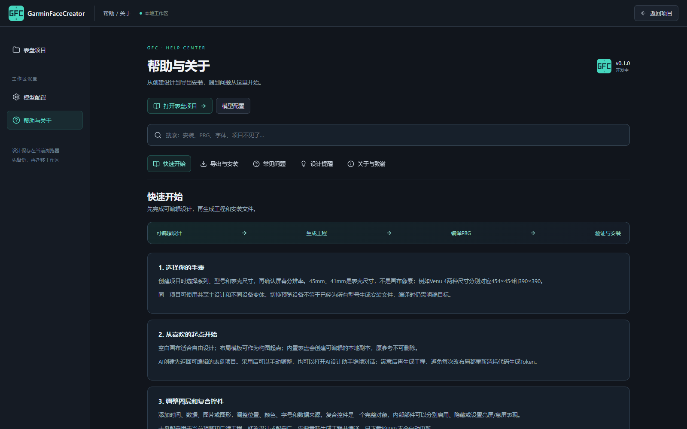

# 帮助与关于

项目列表、模型配置页的侧栏，以及编辑器左侧工具栏底部均提供“帮助与关于”。从编辑器打开后，可点击“返回当前设计”继续编辑，图层、选中状态和工作区保留；帮助页不创建编译任务或调用模型。

## 页面内容

- **快速开始**：选设备、空白/模板/参考/AI起点、复合控件、预览、生成工程与独立编译。
- **导出与安装**：JSON、PNG、源码ZIP和PRG用途对照；目标型号检查、USB侧载及GARMIN/APPS目录；SDK模拟和本机调试的区别。
- **常见问题**：浏览器/域名/端口迁移、本地备份、数据缺失、编译错误、下载凭证与过期、配额、模型接口、字体和内置参考。
- **设计提醒**：实际像素、长读数、对比度、圆屏边界、动态数据与装饰、资源预算及AOD分层验收。
- **关于与致谢**：版本、源码、反馈和GPLv3+边界，按当前参考目录列出来源；另有图标来源、数据流向与规范入口。

搜索覆盖全部分类，支持多个关键词，FAQ可展开；空结果可清除回到原分类。页面按需加载，不在帮助中读取模型密钥或导出当前设计。

“检查服务状态”只在用户点击后GET当前站点能力：分别显示编译目标就绪与可选原生服务状态，十秒超时，可重试；离开页面取消未完成检查。未启用模拟器不表示编译不可用，不显示服务端原始路径或异常详情，不消耗编译/原生任务配额。

## 内容依据与边界

参考[Whiz.tools页面](https://whiz.tools/zh/design-graphics/garmin-watch-face-designer)的文档分类组织，按本项目实际功能重新编写，不复制其编辑器或导出能力。安装依据[Garmin官方侧载说明](https://developer.garmin.com/connect-iq/connect-iq-basics/your-first-app/)，本机工具参考[官方VS Code指南](https://developer.garmin.com/connect-iq/reference-guides/visual-studio-code-extension/)，设计参考[官方界面指南](https://developer.garmin.com/connect-iq/user-experience-guidelines/)。

本站可以编译得到指定设备PRG；JSON/PNG不是安装文件。蓝牙/远程安装和自动商店发布未开放。项目素材通常在浏览器；明确编译后所需工程/资源会提交服务，选择的AI输入发往用户配置接口。网页/SDK/模拟器/实际Sleep与真机功耗仍分别核对，不以文档描述承诺未实现能力。

验证见阶段109；展示环境未更新，测试只在既定测试部署进行。截图是实际界面，不含模型Key或任务凭证。
