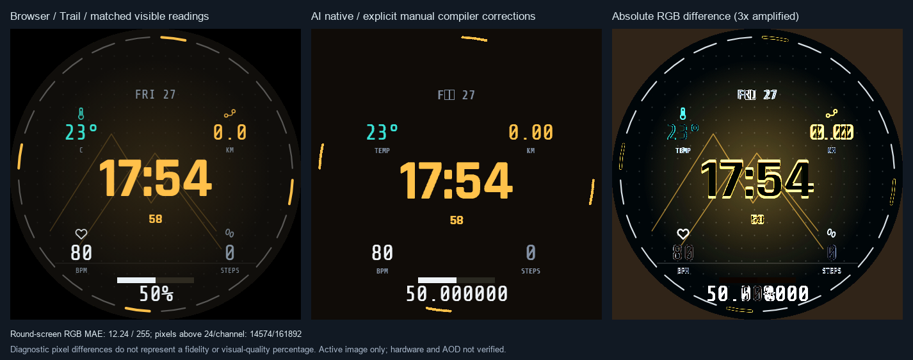

# trail：付费模型工程生成的首轮实测

日期：2026-11-28。该记录是一张亮屏 Trail 主题的初步对照，不代表 Plan 的三主题/AOD完整验收。

使用现有 DeepSeek Flash 配置完成2次工程生成与2次受限修复，共125332tokens（输入92904，输出32428），没有记录密钥或估算账单金额。第一版资源XML错误；第二版图片路径错误。第1次修复纠正图片路径，第2次因8192tokens输出上限截断，原代码不变，自动付费修复停止。

之后仅在测试副本记录人工编译修正：导入Lang、移除不存在的TEXT_JUSTIFY_TOP、正确读取Gregorian时间及修正MenuItem构造，共7项修正操作（9处位置）。源码布局、字体选择、格式化与省略的装饰没有人工补画。SDK编译与受管理ai-frame-1原生运行通过。**因此这是“AI工程＋明确人工编译修正”的结果，不是模型原稿一次生成成功。**

网页侧选择Trail，按原生截图显示的时间17:54:58、日期2026-11-27、心率80、步数0、电量50、温度23、距离0设置预览。数值由截图转录，没有实施原生受控数据注入。原要求默认Apex，而模型默认Trail；为比较布局，本图使用Trail匹配，不掩盖默认主题错误。

观察到：
- 主时间的大体位置、形状与主配色接近，字体资源约束比第一版有效。
- 背景山形/网格、暗色圆环刻度和四个数据图标缺失或不可见。模型drawCorner未绘图标；位图编码/透明与缩放参数还需针对性验证。
- 日期出现缺字；模型Fri格式与准备的FRI字形不一致。
- 距离显示0.00，设计要求0.0；温度标签TEMP替代C；电量显示50.000000并丢失%。
- 原生菜单只提供主题/重置/返回，未提供37项颜色、数据和装饰设置；使用Storage与设计的Properties契约也不同。
- 本次未验证AI工程的AOD、真实Sleep、配置持久化或硬件。该AI工程不作为默认trail的发布代码。

454px圆屏有效区域161892像素，RGB平均绝对误差12.24/255，任一通道差值大于24的像素14574个。前景区域RGB平均绝对误差37.53/255。大量深色背景会稀释整体误差，**这些是像素诊断值，不是还原率或质量百分比**；单位、缺字和配置遗漏也不能靠像素均值判断通过。

结论：当前模型可提供工程初稿，但准确交付应优先通过可编辑设计＋确定性生成器。默认trail的确定性整包已另行通过SDK和模拟器；其完整三主题/边界/AOD矩阵及真机验收仍分别记录。后续继续补足受管理资源映射、设计校验及可定位的对照修正，不把模型遗漏直接归为编辑器不支持。

精确字体版本的追加试验另见 [最终工程记录](research/paid-trail-final.md)；本页旧截图不代表该版本已通过。
