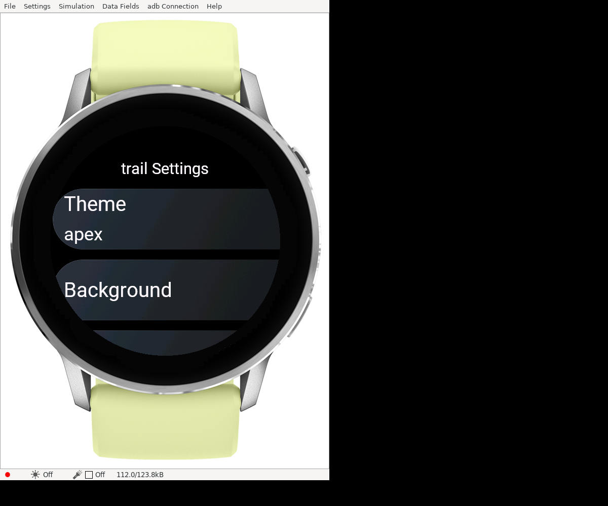
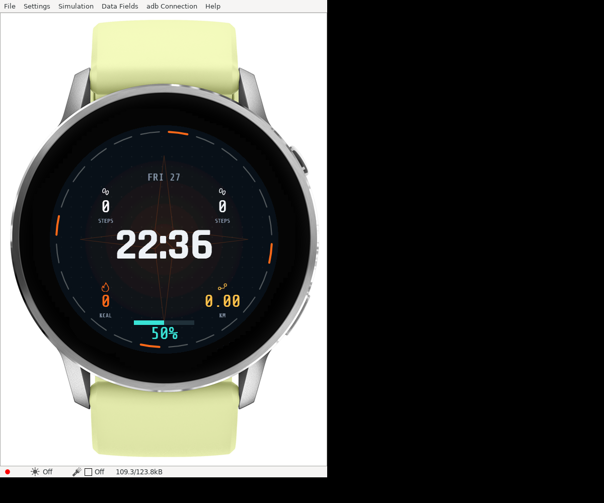
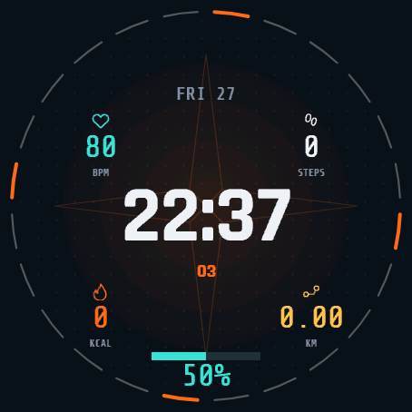

# trail 原生设置：阶段135验证记录

范围为 Venu 4 45mm、SDK 9.3 的隔离模拟器，走正常编译与原生验证配额。每例使用独立测试应用身份；同一例中的主题切换和重启使用同一份 PRG。夹具仅添加观察日志与受限交互标记，不把在源码中强行修改属性当作菜单操作。展示环境未动，没有新增付费模型调用。

## 已实测

- 从模拟器系统 `Trigger App Settings` 进入表盘设置，实际显示 Apex / Trail / Vital；同一 PRG 显示了三套表盘。该组为 basic62，最终版本的固定数据全矩阵仍由后续验收负责。
- 独立修改 Trail 背景为黑色。通过 SDK `File → Quit` 正常退出并重新加载同一 PRG 后，主题仍为 Trail、背景仍为黑色，其余两主题背景未变。已提交的 `capture-native-theme-menu.mjs persistence` 也实际执行并通过。
- 最终 basic66 完整工程从原生菜单依次把 Apex 左上数据改为步数、颜色改为白色、关闭秒数；每步返回表盘并重绘。随后实际点击“重置当前主题”，恢复心率、`#38E1D0`、秒数显示，预先设置的 Trail 黑色背景保留。
- 最后一例五次实际绘制状态的来源代码为 `-1 → 588927973 → 588927973 → 588927973 → 1007610278`。首个 `-1` 是迁移前的初始化哨兵；后四次分别为步数、步数、步数、心率。颜色最终恢复数值3727824，秒数开关恢复true。三个主题的背景属性在整个重置过程中不变。
- 最终例 SDK 成功、原生截图454×454、清理为completed，日志无原生崩溃。两尺寸的最终分组菜单 SDK 编译均通过；41mm原生交互未在本阶段验收。

## 实测发现与修复

1. 前两次交互达到80秒门禁上限，未完成验收，容器正常清理。固定交互序列代替逐次远程试探后完成验证；没有延长worker超时或绕过账本。
2. 强制结束模拟器后再加载PRG会回到默认配置，不能将其当作持久化验证。正常退出路径能保留主题和背景，工具已要求正常退出成功。
3. 完整表盘连续进入设置发生实际 `Out Of Memory Error`。仅复用一个Menu2会继承滚动位置；视图替换方案虽能SDK编译，实际出现 `Symbol Not Found`，该方案已删除。`switchToView`也不应作为表盘设置导航方案。
4. 最终使用已有可用的push/pop：打开子页前删除父菜单项，返回前删除子菜单项，父页显示时重建；保留构造接口以兼容既有调用。根目录改为 `Decorations / Data fields / Colors` 三组，减少同时存活的菜单项与长列表滚动。返回后显式请求重绘，修复中间版本的返回黑屏。
5. 最终连续三组配置加当前主题重置通过，不能据此宣称任意次数无内存泄漏或真机功耗合格。

API“截图成功”与功能通过分别记录：中间的滚动/返回失败即使API成功，也不计入功能通过。原始PNG按字节复制；[完整配置操作日志](theme-settings/grouped-controls-and-current-reset.txt)按原始字节保留为txt（仓库忽略运行产生的.log）；[比较记录](native-theme-settings-comparison.json)保存PRG和源码散列、状态序列、图片散列、失败及清理状态，[交互工具](native-settings-fixture.md)说明授权与时限。

## 仍待验证

- 最终版本三主题固定数据、两尺寸、亮屏/AOD全矩阵；真实Sleep与硬件。
- 非默认数据项、颜色和装饰覆盖的重新启动/升级持久化，旧.SET导入和旧选项迁移的实际文件路径。
- 新主题角色、第三方新契约、最终付费模型输出的完整配置与视觉一致性。

本阶段只补齐上述明确的软件证据，不代表整个Plan完成。前台100/300配额仍是本Plan临时授权，结束须恢复10/30；独立worker的50/日没有自行提高。
