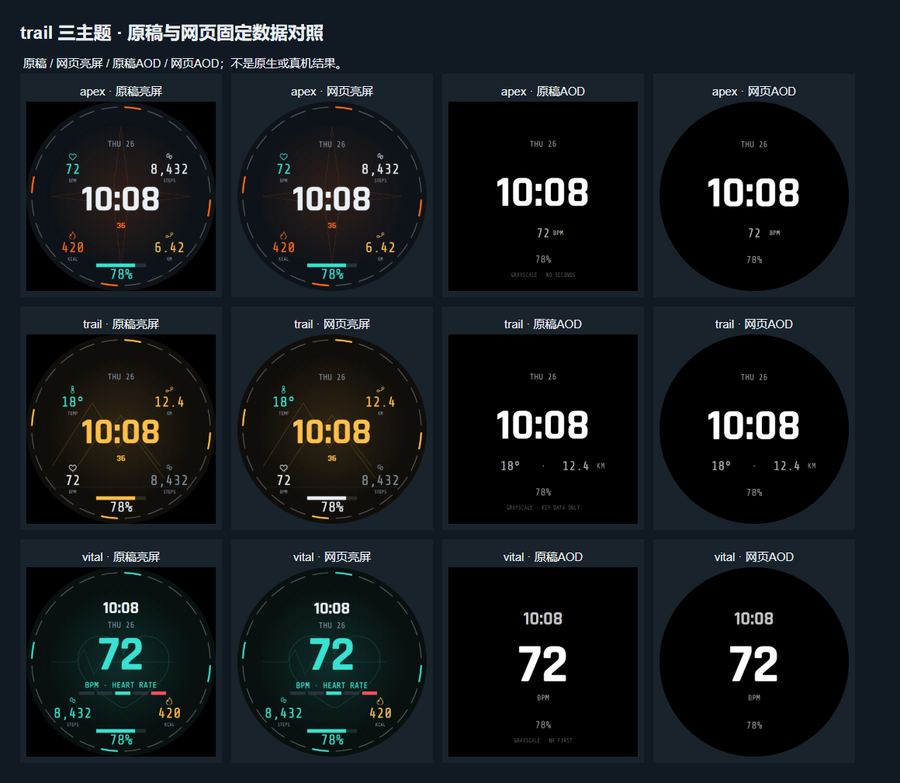

# trail三主题浏览器固定基准

本阶段先定义可复现脚本，再进行113验证。`node scripts/capture-trail-matrix.mjs <授权测试网址>`仅加载页面和字体，使用同一Scene/captureWatchface实现冻结渲染，不调用模型、编译或原生验证。输出默认在忽略的Temp/trail-browser-matrix。

对Apex/Trail/Vital分别生成默认亮屏、默认AOD、高值、缺失、高值AOD、缺失AOD。截图与元数据/项目指纹/资源来源保留；默认及原包边界预览做RGB诊断，不把黑底稀释的MAE叫还原率。

原设计包的previewData与previews/cases.json如有冲突，逐项记录，不静默比较不同读数。默认preview.png以实际previewData为输入；高/缺失按各自用例。此验证是渲染层夹具，不替代编辑器交互、同一个原生PRG全部主题、实际Sleep或真机证据。

视觉发现、像素分析和后续设计调整在运行后补充。所有原稿仍保存在默认参考的design-source，不覆盖作者原始文件。

## 2026-11-28验证结果

实现b81e784，Schema40/basic49，默认参考trail版本1.0.1。15项本地、17项113回归通过；另有整包66文件的45/41mm真实SDK编译均通过。脚本初版入口路径已修正并改为内存构建，无长期本机服务。

三主题共18张冻结网页图、9张AOD完成，无POST、模型、编译或原生任务调用。默认AOD非黑比例：Apex5.95%、Trail6.31%、Vital4.58%；高值/缺失AOD范围1.79%～6.56%。这些是网页估算，低于10%文档参考线不代表原生或真机合规。

**发现并修复**：通用来源标签将Trail默认TEMP改为C、Vital AOD默认BPM改为HEART RATE。新增显式默认标签保留，切换其他来源仍联动；默认/切回/当前选择不同来源后完整原生字形子集均覆盖。原始预设不因当前配置被改写。

**输入冲突**：Trail的previewData.distance=12.4，两个default用例却为6.42。实际原稿默认PNG显示12.4；默认对照采用previewData，并将冲突完整记录，没有偷偷比较不同读数或修改作者原文件。

**保留的明确调整**：移除原稿AOD的说明性页脚；Apex AOD单位位置为三位心率让位；Vital在心率缺失时不展示看似有效的区间装饰。原图与转换图不因此要求像素机械相等。RGB差分仅为定位，逐像素/前景MAE和计数见[结果JSON](trail-browser-matrix-results.json)，没有还原百分比。

原生三主题亮屏/AOD/边界矩阵、单PRG设置交互与重启、真实Sleep/热图和硬件仍待验。原生配额保持10/30，等待用户决定是否仅本Plan临时调整；未通过编译检查绕过原生配额。本文不标记整个Plan完成。
