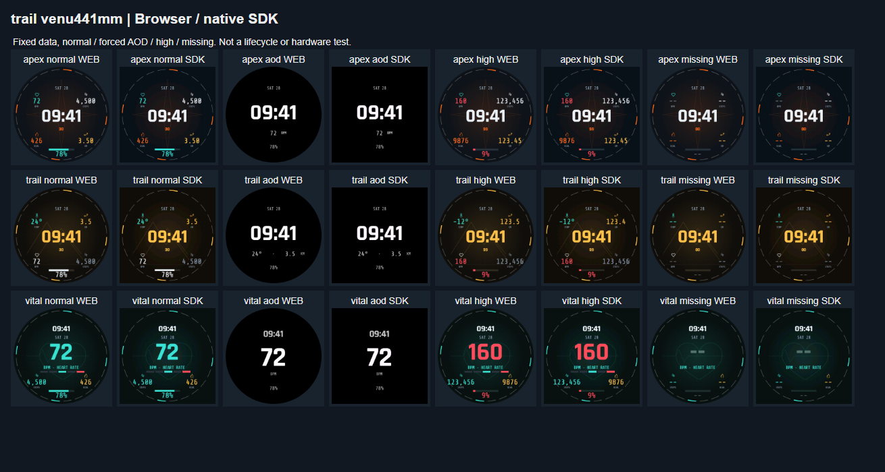

# trail 双尺寸三主题：固定数据原生绘图对照

2026-11-28，basic-76；只使用约定测试环境，展示环境未改。每个目标使用一个完整PRG，含三主题和所有设置/资源；每个PRG按固定正常、强制AOD、高值和缺失四场景采集12帧。不是拆成单主题PRG，也不是设备真实读数、Sleep或硬件测试。

[45mm总览](trail-native-matrix/venu445mm/overview.png)。各目标目录保存12张网页原图、12张SDK Capture Screen原图、固定输入、逐帧VM观察、source/PRG摘要和未调整像素指标；根manifest按字节列出摘要。完整桌面原始帧和失败记录留在本地Temp，不含于公开证据。

- 两尺寸SDK、12场景原生运行与最终cleanup均成功。固定72秒序列在原80秒交互门禁、120秒worker内完成；没有新计时器，也未改变内存/CPU/PIDs/网络/配额账本。
- 正常和高值的布局、数字/单位、图标、日期、红色高心率、低电数字与进度条一致；缺失显示占位、不伪造零；强制AOD隐藏背景装饰和秒数，主读数无碰撞。两尺寸24帧网页导出warnings均为空。细小字缘、暗背景色阶仍存在可见差异，未宣称像素全同。
- 对照仅统计未平移的实际像素，圆屏边缘排除2px，不做图像缩放或配色修正。整屏RGB平均绝对误差为0.261–4.056/255，前景误差另列，不能当作还原率。RGB565量化模型只能解释部分差异，原始未调整数值完整保留；SDK PNG的sBIT实际为8/8/8，不据此虚构底层帧格式。
- AOD网页亮像素比例约4.55%–6.12%；实际Sleep转换、连续烧屏/亮度规则与真实续航仍需独立验证。逐帧System stats是观察点，不是VM精确峰值；Docker采样也不能代替VM内存。

工具修正历史：先有两尺寸完整桌面采集，因桌面与SDK原图暗色RGB不同，像素工具拒绝把桌面裁剪视为等价SDK帧；一次过快文件对话框导致门禁超时并已清理。最终等待SDK文件对话框/路径提交，直接保存每帧原始SDK PNG，保留旧失败。worker截至这两次成功累计98/100；后续付费工程原生失败另计，不清账。

这组证据验收的是确定性生成器的绘图映射。45mm实际菜单、独立来源/颜色/秒数正常退出重载另见native-font-memory/override-restart；41mm实际菜单、跨PRG设置迁移、真实Sleep和硬件不由本绘图矩阵代替。付费模型输出也有独立记录，不能套用本组结果。
