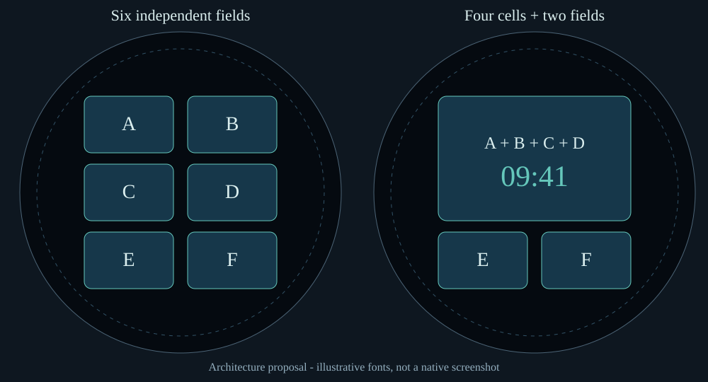

# BYOD 分区与组合控件设计评审

状态：**研究方案，尚未实现分区引擎，不加入默认参考列表**。对应 todo R-08。现有图层分组、确定性生成和数据读取可作为后续试点基础；本阶段不改工程 schema、后端编译边界或用户已有设计。

## 固定来源与核对结果

感谢 [NickSteen/BYOD-Watchface](https://github.com/NickSteen/BYOD-Watchface)，固定版本 [`cd04057cc2a7780747d046f85ec2ef38d2f5f73b`](https://github.com/NickSteen/BYOD-Watchface/tree/cd04057cc2a7780747d046f85ec2ef38d2f5f73b)。保留 [原 LGPLv3](BYOD-LICENSE.txt)、[原 README](BYOD-README.md)，八个实际审阅文件的原始哈希和固定链接在 [来源记录](provenance.json)。不运行上游脚本或二进制，不复制实现类或字体图片进入 Creator。

- `manifest.xml` 仅列 vivoactive / vivoactive_hr，不能据此声明支持圆屏。
- `BYODView.getDisplayOrientation` 按宽高决定 3×2 / 2×3；`Settings.calculateFieldXY` 使用均分矩形坐标，没有圆屏边缘约束。
- `Settings.setField` 将字段 ID 实例化为各个 Field 子类；`Field.mc` 本身只有 settings 属性，不能把它描述为已具备完整类型化组件协议。
- `LargeHourField` 使用两倍 fieldWidth/fieldHeight，说明跨四分区的需求；不能直接沿用并允许其他字段覆盖同一空间。
- `BYODView.onUpdate` 又调用 onSettingsChanged，后者重新创建字段实例；Creator 不沿用逐帧重建组件与重复读取设置的方式。
- `StepsField` 读取实际步数/目标并画进度；Creator 初期复用明确的固定 meterGoal，不把它冒充原来的自动 Garmin 目标。

## 可采纳的组合方式

1. **字段预设是已有图层的组合**。时间、数值、图标、目标条等继续作为真实可编辑子图层。空字段不生成占位数据；替换一个字段按一个事务保留撤销、素材引用与代码过期语义。
2. **分区只决定初始布局**。第一试点把预设实例化为绝对 454 坐标与现有 groupId/groupName，不给原生增加第二套相对布局变换。组内拆分后仍可自由编辑；不承诺设备切换时自动重排。
3. **共享一份数据帧**。预览共用 Preview；原生复用当前时间与数据适配器/缓存。组合控件不自行生成随机数、不各开计时器、不重复启动传感器；位置与太阳数据使用现有受保护的缺失策略。
4. **跨区占用显式检查**。每个实例声明占用槽位集合；拒绝重复槽位、非连续矩形跨区、未知组件和溢出安全区。替换跨区实例前，先展示会被替换的成员，整组提交或取消。
5. **生成器边界保持清楚**。后端继续只校验、编译。前端实例化后按既有 DTO 白名单和确定性生成路径输出；unsupported 控件明确拒绝，不以静态图形假装动态功能。AI 修改仍经过现有 diff/来源/版本流程。

## 圆屏重排草案

[机器可读草案](layout-proposal.json) 的状态是 proposal，**不是已支持的项目 JSON schema**。454 单位圆屏保留 24 单位安全边距，分区四角均在半径 203 内。这个数值是布局草案，不替代目标设备按物理像素换算的布局指导。

| 槽位 | x | y | 宽 | 高 |
| --- | ---: | ---: | ---: | ---: |
| A / B | 91 / 237 | 91 | 126 | 80 |
| C / D | 91 / 237 | 187 | 126 | 80 |
| E / F | 91 / 237 | 283 | 126 | 80 |

六字段方案适合 HH、MM、日期、步数、电量、留空。大时间方案合并 A～D，E/F 放日期和电量。时钟字体必须按实际 Garmin 字体测量，不能把图中的网页字体尺寸直接当作原生像素承诺。更长字段优先换行/缩短标签或选择大分区，不自动裁掉数字。

## 后续实施与验收边界

先做不持久化槽位引擎的“插入组合预设”试点：校验槽位与圆形安全区 → 预览替换 → 一次事务插入已有图层组 → 修改/撤销/持久保存 → 本地生成/完整导出 → Venu 4 45mm 实际运行 → 再检查 390/416。需要永久槽位约束、重新流式布局或嵌套组件时，另立 schema/迁移与交互任务，不能偷偷扩大本研究项。

预设需覆盖空值、长读数、阈值与 AOD，每个字段明确原生支持范围。默认时间可见，动态场景和秒数默认息屏隐藏；不继承上游功耗结论。所有候选必须仍通过 R-C01～06，BYOD 当前没有通过默认参考准入，因此不登记 referenceId、不打包进用户源码工程。

本方案采用组合和分区思想，没有把 BYOD 的类实现改名导入。原 LGPL 文本保持原状，与仓库 GPL 原文分别保留；若将来复制具体实现，必须逐文件记录原许可、对应源码及适用的分发要求，不能把所有内容统称项目主许可。字体/图标需另行核查后才考虑复制。本阶段不作自动重许可判断。

## 本次可验证产物

固定来源记录、原许可/README、圆屏示意图与槽位草案随构建发布到 `research/byod/`，便于核对文本字节与几何。它们属于研究资料，不是分区运行时或默认表盘。研究图标字体为网页示意，无上游二进制资源。实际程序功能保持以当前可用控件和参考为准。
