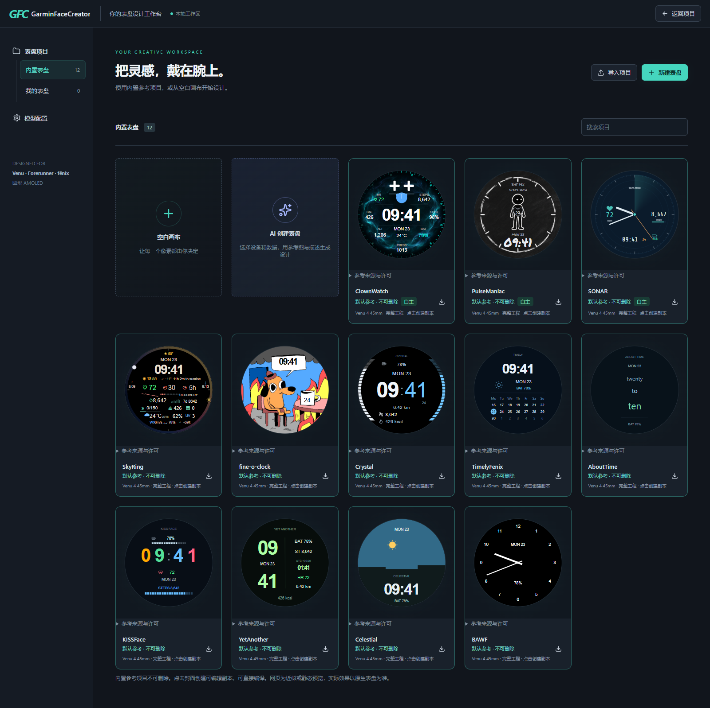
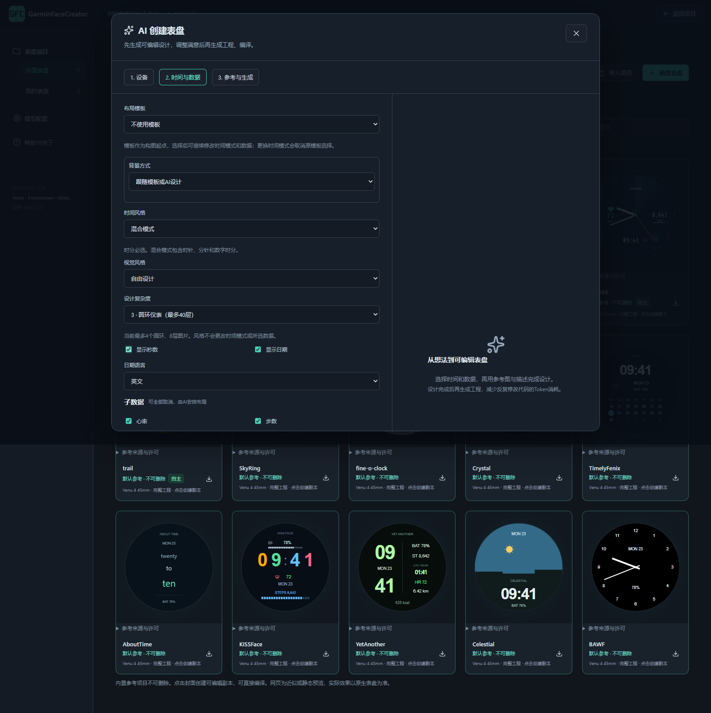
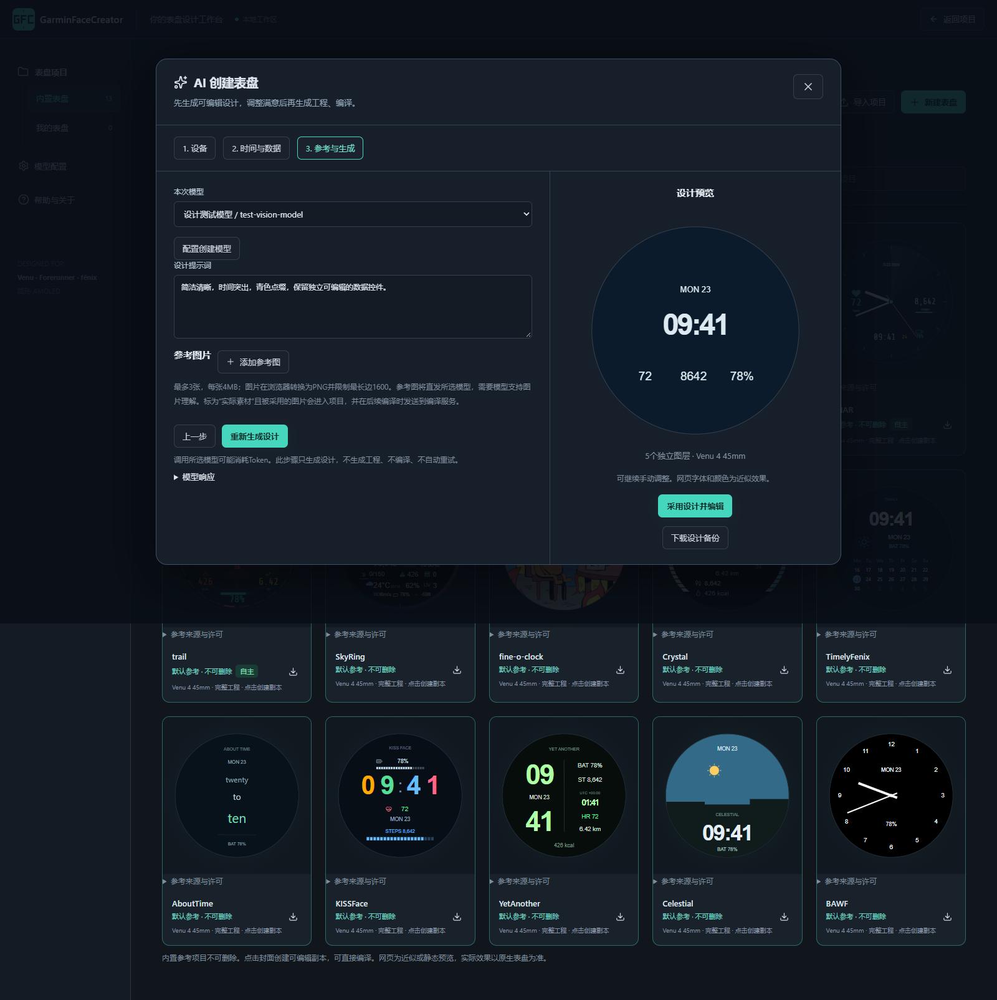
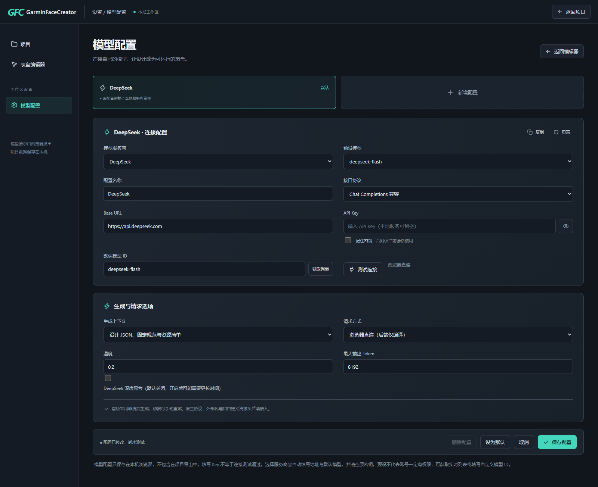
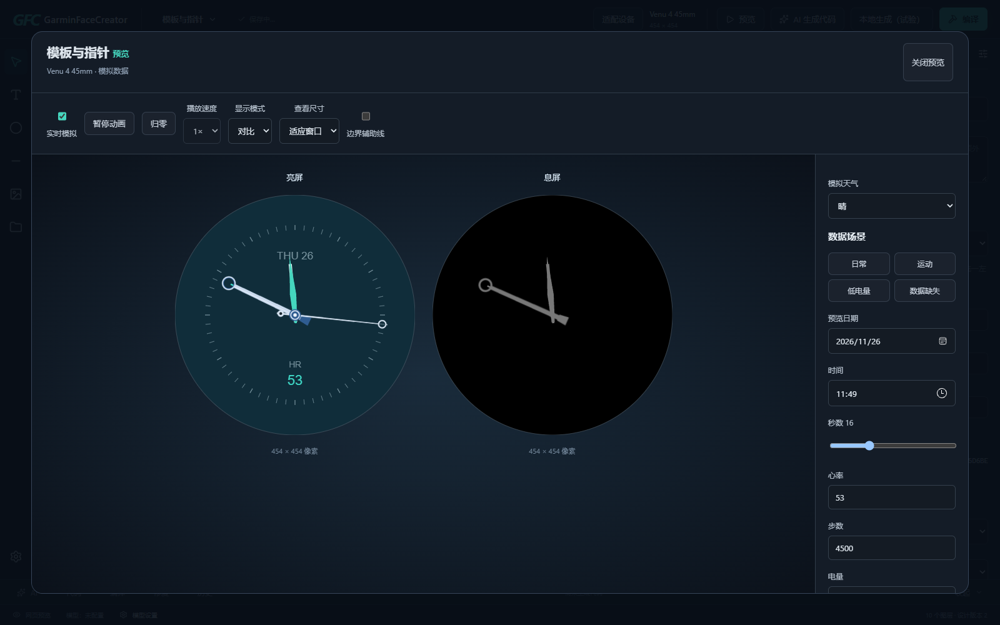
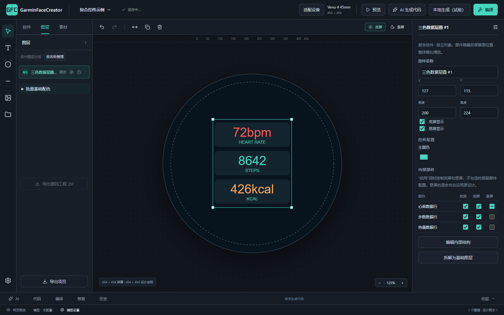
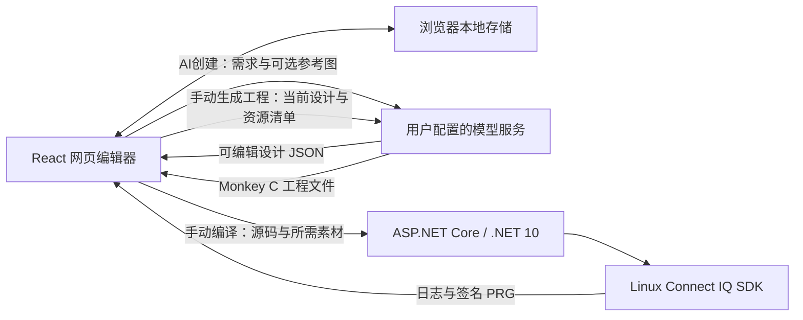

# GarminFaceCreator

**简体中文** | [English](README.en.md)

面向 Garmin Connect IQ 的可视化表盘设计器。可以从空白画布、内置参考或 AI 创建开始，先得到可编辑的表盘设计；调整满意后，再按需调用自行配置的大模型生成 Monkey C 工程，最后交给 .NET 后端编译为 PRG。

> 项目仍在开发中。网页预览采用模拟数据，编译成功不代表已完成真机验证。

## 在线体验

[打开 GarminFaceCreator 公开体验站](https://ddd.yusg.xyz:61888)

支持设计、预览、AI 创建及真实 PRG 编译。匿名体验默认每个 IP 每分钟最多提交 6 次、每天编译 30 次，全站每天 200 次；配额按北京时间重置，同一公网 IP 的访问者共享配额。模型需自行配置，调用费用由相应模型服务商收取。

任务查询、日志、下载和取消均使用独立访问凭证；凭证保存在当前浏览器会话，不随项目导出。丢失会话或升级前的旧任务需要重新编译。公开站不适合上传敏感项目；生产使用建议自行部署。详见[公开体验站防护与限制](docs/public-demo-security.md)。

## 页面截图

### 项目与默认参考



“表盘项目”分为“内置表盘”和“我的表盘”：默认参考不可删除，使用时创建本地副本；自主参考优先排列。

### AI 创建表盘

选择时间风格、秒数、日期和所需子数据，配合设备、模型、参考图和提示词生成设计。





以上AI向导截图使用固定测试响应，展示操作与数据链路，不代表真实模型的设计质量。另见[设备选择](docs/screenshots/ai-create-device.png)和[混合模式示例](docs/screenshots/ai-create-41mm.png)。

### 可视化编辑器


### 动态预览与亮屏／息屏对比


### 模型配置



## 已实现功能

- 素材库内置胶囊数据行、分段电量轨、图标数据列和三色数据层叠；添加为单个复合对象，支持整体操作、右侧部件启用/亮屏/息屏开关、内部编辑及拆解，源码附带许可。

- 内置表盘与我的表盘分类管理、分类搜索、自主参考标签与排序；原子本地保存、冲突恢复、版本迁移及设计 JSON 导入/导出。
- AI 创建设计：选择系列/型号/尺寸、数字/指针/混合模式、秒/日期和子数据，加入参考图及提示词，生成独立可编辑图层，预览后采用。
- 设计、工程和编译分开触发；手动调整不调用模型，支持取消、错误/截断提示、响应下载，以及保存失败后的设计备份和重试。
- 控件可保存原生效果说明，随当前设计传递给后续AI工程生成；网页显示基础布局，本地生成明确提示不支持该说明。
- 圆形画布、四角缩放、多选/框选、吸附、批量操作和对齐、撤销与重做。
- 时间、日期、数据、文字、图片、圆环及基础图形控件。
- 独立预览：当前时间、随机心率、累加步数、场景切换、播放暂停、亮屏与息屏对比。
- 创建项目时选择系列、型号、表壳尺寸，显示实际屏幕分辨率；同一项目可添加多个设备，共享主设计并分别微调、生成代码与编译。
- 可选 AI 辅助设备适配：查看发送内容、对比建议效果后应用到当前设备，自动保留调整前设计快照。
- 自有设计 PulseManiac 四态静态默认参考：按心率切换人物，顶部数据区可配置，完整胸口心形内实时心率、低亮度顶部数据与手写粉笔时间；预备态已统一为黑色头部。
- 图层可按心率、步数或电量条件显示，支持上下限、缺失及息屏回退；静态 PNG 按目标设备尺寸编译。
- 12 个受保护的默认参考：ClownWatch、SkyRing、fine-o-clock、Crystal、TimelyFenix、AboutTime、KISSFace、YetAnother、Celestial、BAWF、PulseManiac、SONAR；使用时创建独立副本。
- 模型服务商预设、自定义兼容接口、连接测试和模型列表获取。
- 独立设计/代码快照及保留策略；代码生成、失败原文恢复、审阅和过期检测。
- 可配置圆环、阈值兜底、文字/数据格式及独立息屏样式；网页边界检查与定位。
- 源码工程 ZIP 导出，附版本信息、完整资源与适用的第三方声明。
- 按目标检查编译就绪，增量日志/断线续看、取消、超时、产物保留与签名 PRG 下载。
- 下载文件名：`型号_尺寸_项目名称.prg`，移除空格并处理非法字符。

已提供用户主动触发、最多两轮的受控 AI 修复与差异审阅，以及目标、格式、许可和来源约束。已提供受审阅的 AI 设备布局建议；无人值守调整/修复和完整原生模拟器预览仍是后续方向。部分参考项目包含近似图层或动画静帧，实际绘制以原生工程为准。

## 布局模板与素材交付

空白创建和 AI 创建均可选择 12 个可编辑布局模板，再选择纯色或本地图片背景。背景图片在浏览器中处理，不会自动作为模型参考图发送；编译时随工程提交。素材库提供 10 套原图指针及 3 种矢量样式，支持整套添加后逐个调整。

统一维护目录为 `resources/`，包含默认表盘、布局模板、控件、图片及共享字体。构建过程发布网页资源，已保存项目的旧资源 URL 保持兼容。





第三方交付请参阅[自定义控件规范](docs/standards/custom-widget-standard.md)、[布局模板规范](docs/standards/layout-template-standard.md)和[指针素材规范](docs/standards/hand-resource-standard.md)。当前控件规范支持已实现图层的组合；新增运行时效果仍需程序支持。

## 从设计到 PRG

| 步骤 | 操作 | 是否调用模型 |
| --- | --- | --- |
| 1. 创建设计 | 点击空白画布旁的“AI 创建表盘”，选择设备、时间风格、数据、参考图和提示词，再点击“生成表盘项目” | 明确生成时调用一次，不自动重试 |
| 2. 调整设计 | 检查预览，点击“采用设计并编辑”；移动控件、修改颜色/字号/来源、替换素材并保存 | 不调用 |
| 3. 生成工程 | 满意后点击“AI 生成代码”→“生成完整工程”，审阅并应用结果；支持范围内也可选择“本地生成（试验）” | AI生成调用；本地生成不调用 |
| 4. 编译下载 | 点击“编译”，检查日志并下载PRG | 不调用 |

设计变化后工程会标为过期，旧代码保留历史，不自动重新生成。也可以直接使用内置参考副本或从空白画布手动设计，无需先进行AI创建设计。

AI创建首版提供24小时制和整数秒；12h/AMPM、农历、节气、节假日、通知数及平滑扫秒暂未开放。参考图分为风格参考、布局参考和实际素材；仅实际素材被引用后进入项目。图片输入需要模型支持图片理解，首版不提供自动生图。

特殊原生效果在生成工程时由模型实现，网页仅显示基础或静态近似，实际效果需模拟器/真机核对。详见[AI创建操作说明](docs/ai-create.md)及[基础规范v1.1](docs/standards/watchface-basic-spec.md)。

## 支持设备

| 系列 | 型号 | 表壳尺寸 | 屏幕分辨率 |
| --- | --- | --- | --- |
| Venu | Venu 4 | 41 / 45mm | 390 / 454 |
| Venu | Venu 3 / 3S | 45 / 41mm | 454 / 390 |
| Forerunner | Forerunner 570 | 42 / 47mm | 390 / 454 |
| Forerunner | Forerunner 970 | 47mm | 454 |
| fēnix | fēnix 8 AMOLED | 43 / 47 / 51mm | 416 / 454 / 454 |

均为圆形 AMOLED。设计使用统一的 454×454 坐标，生成提示包含目标型号、实际分辨率与缩放要求。内置参考工程当前以 Venu 4 45mm 为目标，可在其独立副本中添加设备适配，但仍需逐设备生成、编译与验证。见[多设备适配说明](docs/multi-device.md)。

## 架构与数据流



- API Key 保存在浏览器，可选仅会话保存或记住；不进入提示词、普通项目导出或编译后端。
- 参考图由浏览器直接发送给所选模型，设计阶段不发送到编译服务；被采用为运行素材的图片保存在本地项目，后续编译会上传所需素材。
- 模型请求由浏览器直连，服务商需要允许 CORS；后端不提供模型代理。
- 编译服务不执行上传的 Shell 或构建脚本。
- 编译配额、上传超时、存储预算及审计日志上限统一在 [backend/appsettings.json](backend/appsettings.json) 中配置，修改后需重启后端；已用次数单独持久化。
- 支持带限流、每日配额和任务访问凭证的匿名体验；尚未提供账号登录、完整多租户隔离或专业 DDoS 防护。详见[公开部署防护说明](docs/public-demo-security.md)。

## 开始使用

需要 Node.js 24、.NET 10 SDK。编译表盘还需 Docker、Java 17、Linux Connect IQ SDK、目标设备包、字体和自行保管的签名密钥。

```bash
git clone https://github.com/yusger/GarminFaceCreator.git
cd GarminFaceCreator
npm ci
npm run build
dotnet build backend/GarminFaceCreator.Api.csproj -c Release
```

仅开发前端：`npm run dev`，默认访问 `http://localhost:5173`。未连接编译服务时可以编辑和导出设计，不能生成 PRG。

完整部署、SDK 初始化与目录挂载见 [后端部署说明](docs/backend-deployment.md)。SDK、设备包、字体和私钥不随仓库分发，需要自行准备。

## 文档与目录

- [AI创建表盘：设计、调整、生成工程与编译](docs/ai-create.md)
- [表盘设计基础规范v1.1](docs/standards/watchface-basic-spec.md)
- [设计包接入规范v1.2](docs/standards/watchface-package-standard.md)
- [SONAR样包与历史评审](docs/sonar-package-review.md)
- [页面使用与功能范围](docs/frontend-running.md)
- [后端 API 与容器部署](docs/backend-deployment.md)
- [前端设计规划](docs/frontend-design.md)
- [源码工程导出](docs/source-export.md)
- [内容来源与许可分发](docs/attribution.md)
- [内置图标素材库](docs/icon-library.md)
- [本地生成试点](docs/local-generator.md)
- [受限 AI 修复](docs/ai-repair.md)
- [设备与隐私自测](docs/device-self-test.md)
- [预览差异与验证范围](docs/preview-limitations.md)
- [问题反馈与功能建议](https://github.com/yusger/GarminFaceCreator/issues/new/choose)
- [分阶段验证记录](docs/stage-validation.md)

```text
frontend/         React、TypeScript、SVG 编辑器与参考包
backend/          .NET 10 编译 API 与集成测试
deploy/           Dockerfile、初始化与辅助脚本
scripts/          参考包生成工具
docs/             使用说明、设计文档与页面截图
compose.yaml      容器运行配置
```

运行页面测试：`npm test`。可用 `GFC_TEST_URL` 指定已部署的服务，避免启动本地开发服务器。真实模型测试需自行提供环境变量中的 Key，可能产生服务商费用。

## 参考项目与致谢

默认参考表盘中的以下项目来自社区公开仓库，本项目在其基础上进行了适配和编辑器集成：

- **SkyRing**：[daveshap/SkyRingGarmin](https://github.com/daveshap/SkyRingGarmin)，作者 [daveshap](https://github.com/daveshap)。
- **fine-o-clock / Fine’o clock**：[causeri3/fine-o-clock](https://github.com/causeri3/fine-o-clock)，作者 [causeri3](https://github.com/causeri3)。

感谢两位作者公开分享表盘源码与设计，为参考项目的布局、数据展示和动画实现提供了基础，也让可视化编辑与编译流程有了可供学习的实例。原项目及资源的版权和许可仍归各自权利人所有。

## 开源许可与第三方内容

项目按 [GNU GPL v3 或更新版本](LICENSE) 发布。第三方参考工程、字体和图片仍保留各自版权与许可，见 [第三方说明](THIRD_PARTY_NOTICES.md)。项目许可证不会额外授予商标、角色形象或插画的使用权。

许可核对：SkyRing 上游许可尚未核实；fine-o-clock 的 README 与 LICENCE 存在 GPLv3+/LGPLv3 差异，已原样保留并说明。详见第三方说明，不将公开源码等同于授权完备。

素材页现支持 Lucide/Meteocons 静态图标及 Monochrome 缓存天气绑定；网页天气为模拟场景，原生读取 Garmin 缓存。昼夜样式首版手动选择，缺失显示 N/A；不会自动定位或请求外部天气服务。

新增 **Crystal 可编辑参考**：感谢 [warmsound/crystal-face](https://github.com/warmsound/crystal-face)。包含独立小时/分钟、日期、真实基础数据和弧形目标仪表；首版 Venu 4 45mm，固定上游提交、完整 GPLv3 许可与[精简范围](frontend/public/reference-notices/Crystal-ADAPTATION.md)均保留，使用系统字体和已核查 Lucide 图标。

Crystal：[编辑器画面](docs/screenshots/crystal-editor.png) · [原生亮屏](docs/screenshots/crystal-native.png) · [原生息屏](docs/screenshots/crystal-aod.png)。

新增 **TimelyFenix 可编辑参考**：感谢 [KWottrich/TimelyFenix](https://github.com/KWottrich/TimelyFenix)。动态三周日历、周起始日/今日配色和 Garmin 缓存天气均可编辑；固定 GPLv3 来源与[适配范围](frontend/public/reference-notices/TimelyFenix-ADAPTATION.md)保留，不复制原图标字体。

TimelyFenix：[编辑器](docs/screenshots/timelyfenix-editor.png) · [原生亮屏](docs/screenshots/timelyfenix-native.png) · [天气缺失](docs/screenshots/timelyfenix-missing.png) · [息屏](docs/screenshots/timelyfenix-aod.png)。

新增 **AboutTime 文字报时参考**：感谢 [Samuel Rinnetmäki / garmin-abouttime](https://github.com/samuelmr/garmin-abouttime)。三行可分别布局、配色和选择中英文；原译文 MIT 与 Creator 原生模板 GPLv3+ 范围分别保留，见[适配说明](frontend/public/reference-notices/AboutTime-ADAPTATION.md)。

AboutTime：[英文编辑器](docs/screenshots/abouttime-editor.png) · [中文编辑器](docs/screenshots/abouttime-zh-editor.png) · [原生英文](docs/screenshots/abouttime-en-native.png) · [原生中文](docs/screenshots/abouttime-zh-native.png) · [息屏](docs/screenshots/abouttime-aod.png)。


新增 **KISSFace 彩色时间参考**：感谢 [Delfim Machado / KISSFace](https://github.com/dbcm/KISSFace)。四个时间数字独立配色，缓存心率和电量支持阈值，步数/电量使用动态分段目标条。原版液面字形与外圈弧线采用明确降级，详见[适配范围](frontend/public/reference-notices/KISSFace-ADAPTATION.md)。


新增 **YetAnother 综合数据参考**：感谢 [Laverlin / Yet-Another-WatchFace](https://github.com/Laverlin/Yet-Another-WatchFace)。分列 HH/MM、实际活动数据与可选第二时区均可编辑；第二时区采用固定 UTC 偏移，不自动调整目标地区夏令时。见[精简范围](frontend/public/reference-notices/YetAnother-ADAPTATION.md)。


新增 **Celestial 昼夜场景参考**：感谢 [Zachary Smith / Cutwell](https://github.com/Cutwell/garmin-celestial-watchface)。天空、日月标记、地景、时间与电量可独立编辑；原生使用 Garmin 日出/日落和被动缓存位置，无位置时明确回退。网页天文时间是预览样本，见[适配范围](frontend/public/reference-notices/Celestial-ADAPTATION.md)。


BYOD 的六分区/跨区思路已形成[圆屏组合控件研究方案](docs/byod-modular-layout.md)，保留固定版本、原 LGPL 许可和来源文件记录；目前是设计草案，不加入默认参考，也未实现分区引擎。


新增 **BAWF 黑白指针参考**：感谢 [Kevin Boone / BAWF](https://github.com/kevinboone/BAWF)。保留原源码明确的 GPLv3 版权头并补齐许可原文；时针、分针、时标、日期与电量均可编辑，支持同一 Jungle 下的黑白设计变体。见[适配范围](frontend/public/reference-notices/BAWF-ADAPTATION.md)，不直接继承原省电结论。

可编辑控件还包括分段目标仪表、三周日历、中英文文字报时、固定 UTC 偏移时间、昼夜场景及可配置转轴的动态指针。范围与验证记录见 [todo](todo.md) 和 [分阶段验收](docs/stage-validation.md)。


PulseManiac 的[创建、配置与素材说明](docs/pulsemaniac.md)包含实际网页/原生截图；人物 PNG 及生成提示词随项目保存，原始草稿仍留在不提交的本地临时目录。


默认参考表盘的独立目录与统一描述格式见 [default-watchfaces](resources/default-watchfaces/README.md)。ClownWatch、PulseManiac 与 SONAR 在内置卡片上标记“自主”；具体素材权利仍以各包 notices 为准。


[SONAR默认参考](docs/sonar.md)：18个独立图层、12项配置、连续进度与包内字体；扫描首版静态。


- [AI 设计助手：对话调整表盘](docs/design-chat.md)
