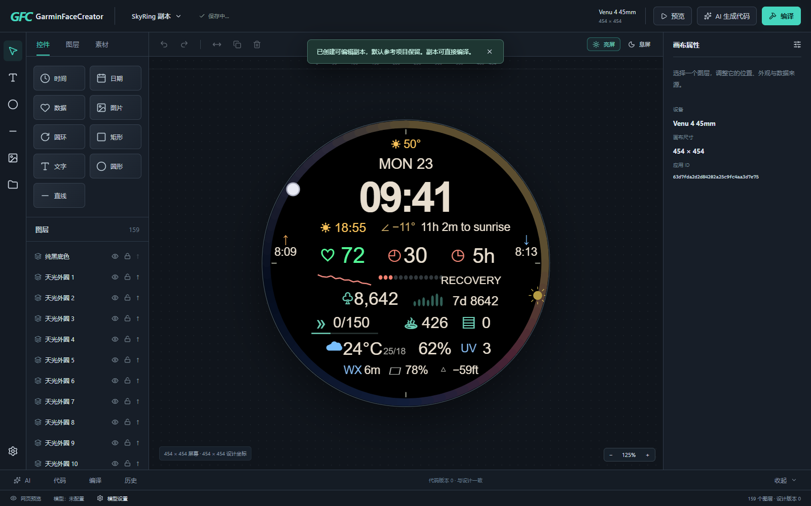
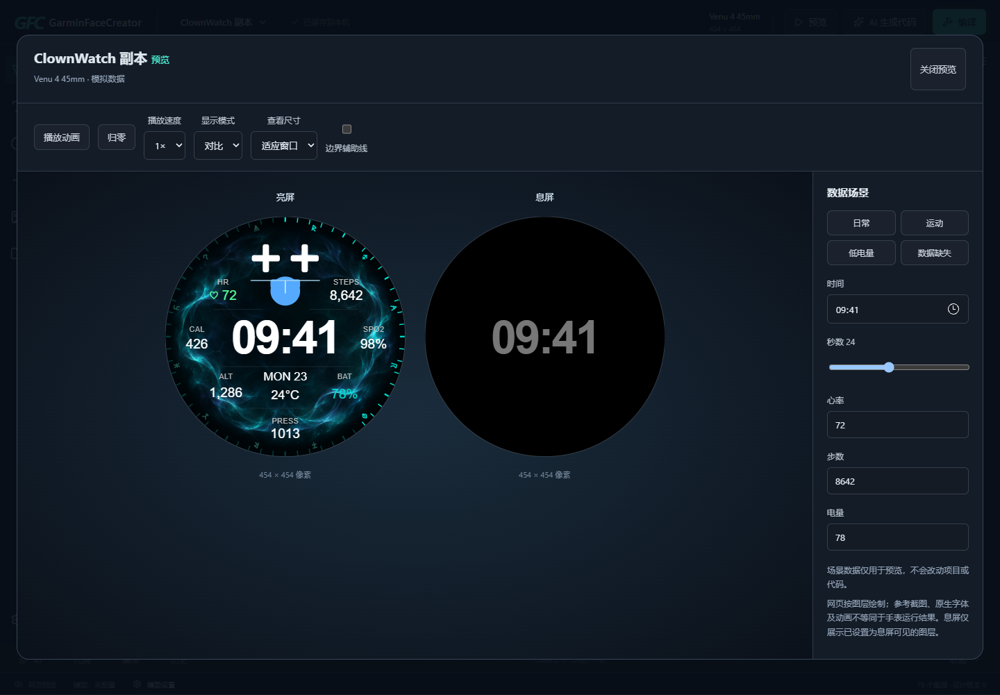
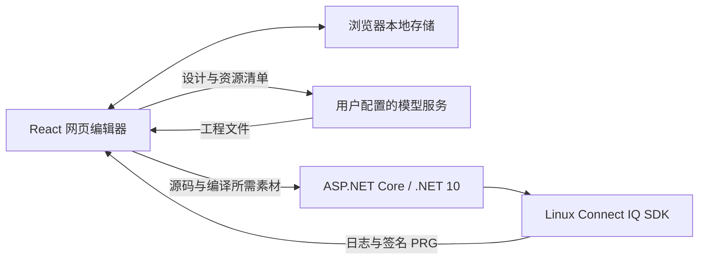

# GarminFaceCreator

**简体中文** | [English](README.en.md)

面向 Garmin Connect IQ 的可视化表盘设计器。通过网页拖动控件、管理图层和素材，在浏览器中调用自行配置的大模型生成 Monkey C 工程，再交给 .NET 后端编译为 PRG。

> 项目仍在开发中。网页预览采用模拟数据，编译成功不代表已完成真机验证。

## 页面截图

### 项目与默认参考


### 可视化编辑器



### 动态预览与亮屏／息屏对比



### 模型配置


## 已实现功能

- 项目管理、原子本地保存与冲突恢复、版本迁移、设计 JSON 导入与导出。
- 圆形画布、四角缩放、多选/框选、吸附、批量操作和对齐、撤销与重做。
- 时间、日期、数据、文字、图片、圆环及基础图形控件。
- 独立预览：当前时间、随机心率、累加步数、场景切换、播放暂停、亮屏与息屏对比。
- 创建项目时选择系列、型号、表壳尺寸，显示实际屏幕分辨率。
- ClownWatch、SkyRing、fine-o-clock 默认参考项目；使用时创建独立副本。
- 模型服务商预设、自定义兼容接口、连接测试和模型列表获取。
- 独立设计/代码快照及保留策略；代码生成、失败原文恢复、审阅和过期检测。
- 可配置圆环、阈值兜底、文字/数据格式及独立息屏样式；网页边界检查与定位。
- 源码工程 ZIP 导出，附版本信息、完整资源与适用的第三方声明。
- 按目标检查编译就绪，增量日志/断线续看、取消、超时、产物保留与签名 PRG 下载。
- 下载文件名：`型号_尺寸_项目名称.prg`，移除空格并处理非法字符。

AI 辅助修改画布、自动编译修复和完整原生模拟器预览尚未实现。部分参考项目包含近似图层或动画静帧，实际绘制以原生工程为准。

## 支持设备

| 系列 | 型号 | 表壳尺寸 | 屏幕分辨率 |
| --- | --- | --- | --- |
| Venu | Venu 4 | 41 / 45mm | 390 / 454 |
| Venu | Venu 3 / 3S | 45 / 41mm | 454 / 390 |
| Forerunner | Forerunner 570 | 42 / 47mm | 390 / 454 |
| Forerunner | Forerunner 970 | 47mm | 454 |
| fēnix | fēnix 8 AMOLED | 43 / 47 / 51mm | 416 / 454 / 454 |

均为圆形 AMOLED。设计使用统一的 454×454 坐标，生成提示包含目标型号、实际分辨率与缩放要求。内置参考工程当前以 Venu 4 45mm 为目标，不自动保证跨设备适配。

## 架构与数据流



- API Key 保存在浏览器，可选仅会话保存或记住；不进入提示词、普通项目导出或编译后端。
- 图片保存在浏览器；当前编译流程会上传所需素材，不是完全离线的素材方案。
- 模型请求由浏览器直连，服务商需要允许 CORS；后端不提供模型代理。
- 编译服务不执行上传的 Shell 或构建脚本。
- 当前面向自托管个人环境，尚未提供登录认证和多用户隔离。

## 开始使用

需要 Node.js 24、.NET 10 SDK。编译表盘还需 Docker、Java 17、Linux Connect IQ SDK、目标设备包、字体和自行保管的签名密钥。

```bash
git clone https://github.com/yusger/GarminFaceCreator.git
cd GarminFaceCreator
npm ci
npm run build
dotnet build backend/GarminFaceCreator.Api.csproj -c Release
```

仅开发前端：`npm run dev`，默认访问 `http://localhost:5173`。未连接编译服务时可以编辑和导出设计，不能生成 PRG。

完整部署、SDK 初始化与目录挂载见 [后端部署说明](docs/backend-deployment.md)。SDK、设备包、字体和私钥不随仓库分发，需要自行准备。

## 文档与目录

- [页面使用与功能范围](docs/frontend-running.md)
- [后端 API 与容器部署](docs/backend-deployment.md)
- [前端设计规划](docs/frontend-design.md)
- [源码工程导出](docs/source-export.md)
- [内容来源与许可分发](docs/attribution.md)
- [内置图标素材库](docs/icon-library.md)
- [本地生成试点](docs/local-generator.md)
- [受限 AI 修复](docs/ai-repair.md)
- [设备与隐私自测](docs/device-self-test.md)
- [预览差异与验证范围](docs/preview-limitations.md)
- [问题反馈与功能建议](https://github.com/yusger/GarminFaceCreator/issues/new/choose)
- [分阶段验证记录](docs/stage-validation.md)

```text
frontend/         React、TypeScript、SVG 编辑器与参考包
backend/          .NET 10 编译 API 与集成测试
deploy/           Dockerfile、初始化与辅助脚本
scripts/          参考包生成工具
docs/             使用说明、设计文档与页面截图
compose.yaml      容器运行配置
```

运行页面测试：`npm test`。可用 `GFC_TEST_URL` 指定已部署的服务，避免启动本地开发服务器。真实模型测试需自行提供环境变量中的 Key，可能产生服务商费用。

## 参考项目与致谢

默认参考表盘中的以下项目来自社区公开仓库，本项目在其基础上进行了适配和编辑器集成：

- **SkyRing**：[daveshap/SkyRingGarmin](https://github.com/daveshap/SkyRingGarmin)，作者 [daveshap](https://github.com/daveshap)。
- **fine-o-clock / Fine’o clock**：[causeri3/fine-o-clock](https://github.com/causeri3/fine-o-clock)，作者 [causeri3](https://github.com/causeri3)。

感谢两位作者公开分享表盘源码与设计，为参考项目的布局、数据展示和动画实现提供了基础，也让可视化编辑与编译流程有了可供学习的实例。原项目及资源的版权和许可仍归各自权利人所有。

## 开源许可与第三方内容

项目按 [GNU GPL v3 或更新版本](LICENSE) 发布。第三方参考工程、字体和图片仍保留各自版权与许可，见 [第三方说明](THIRD_PARTY_NOTICES.md)。项目许可证不会额外授予商标、角色形象或插画的使用权。

许可核对：SkyRing 上游许可尚未核实；fine-o-clock 的 README 与 LICENCE 存在 GPLv3+/LGPLv3 差异，已原样保留并说明。详见第三方说明，不将公开源码等同于授权完备。

素材页现支持 Lucide/Meteocons 静态图标及 Monochrome 缓存天气绑定；网页天气为模拟场景，原生读取 Garmin 缓存。昼夜样式首版手动选择，缺失显示 N/A；不会自动定位或请求外部天气服务。

新增 **Crystal 可编辑参考**：感谢 [warmsound/crystal-face](https://github.com/warmsound/crystal-face)。包含独立小时/分钟、日期、真实基础数据和弧形目标仪表；首版 Venu 4 45mm，固定上游提交、完整 GPLv3 许可与[精简范围](frontend/public/reference-notices/Crystal-ADAPTATION.md)均保留，使用系统字体和已核查 Lucide 图标。

Crystal：[编辑器画面](docs/screenshots/crystal-editor.png) · [原生亮屏](docs/screenshots/crystal-native.png) · [原生息屏](docs/screenshots/crystal-aod.png)。

新增 **TimelyFenix 可编辑参考**：感谢 [KWottrich/TimelyFenix](https://github.com/KWottrich/TimelyFenix)。动态三周日历、周起始日/今日配色和 Garmin 缓存天气均可编辑；固定 GPLv3 来源与[适配范围](frontend/public/reference-notices/TimelyFenix-ADAPTATION.md)保留，不复制原图标字体。

TimelyFenix：[编辑器](docs/screenshots/timelyfenix-editor.png) · [原生亮屏](docs/screenshots/timelyfenix-native.png) · [天气缺失](docs/screenshots/timelyfenix-missing.png) · [息屏](docs/screenshots/timelyfenix-aod.png)。

新增 **AboutTime 文字报时参考**：感谢 [Samuel Rinnetmäki / garmin-abouttime](https://github.com/samuelmr/garmin-abouttime)。三行可分别布局、配色和选择中英文；原译文 MIT 与 Creator 原生模板 GPLv3+ 范围分别保留，见[适配说明](frontend/public/reference-notices/AboutTime-ADAPTATION.md)。

AboutTime：[英文编辑器](docs/screenshots/abouttime-editor.png) · [中文编辑器](docs/screenshots/abouttime-zh-editor.png) · [原生英文](docs/screenshots/abouttime-en-native.png) · [原生中文](docs/screenshots/abouttime-zh-native.png) · [息屏](docs/screenshots/abouttime-aod.png)。


新增 **KISSFace 彩色时间参考**：感谢 [Delfim Machado / KISSFace](https://github.com/dbcm/KISSFace)。四个时间数字独立配色，缓存心率和电量支持阈值，步数/电量使用动态分段目标条。原版液面字形与外圈弧线采用明确降级，详见[适配范围](frontend/public/reference-notices/KISSFace-ADAPTATION.md)。


新增 **YetAnother 综合数据参考**：感谢 [Laverlin / Yet-Another-WatchFace](https://github.com/Laverlin/Yet-Another-WatchFace)。分列 HH/MM、实际活动数据与可选第二时区均可编辑；第二时区采用固定 UTC 偏移，不自动调整目标地区夏令时。见[精简范围](frontend/public/reference-notices/YetAnother-ADAPTATION.md)。


新增 **Celestial 昼夜场景参考**：感谢 [Zachary Smith / Cutwell](https://github.com/Cutwell/garmin-celestial-watchface)。天空、日月标记、地景、时间与电量可独立编辑；原生使用 Garmin 日出/日落和被动缓存位置，无位置时明确回退。网页天文时间是预览样本，见[适配范围](frontend/public/reference-notices/Celestial-ADAPTATION.md)。


BYOD 的六分区/跨区思路已形成[圆屏组合控件研究方案](docs/byod-modular-layout.md)，保留固定版本、原 LGPL 许可和来源文件记录；目前是设计草案，不加入默认参考，也未实现分区引擎。
